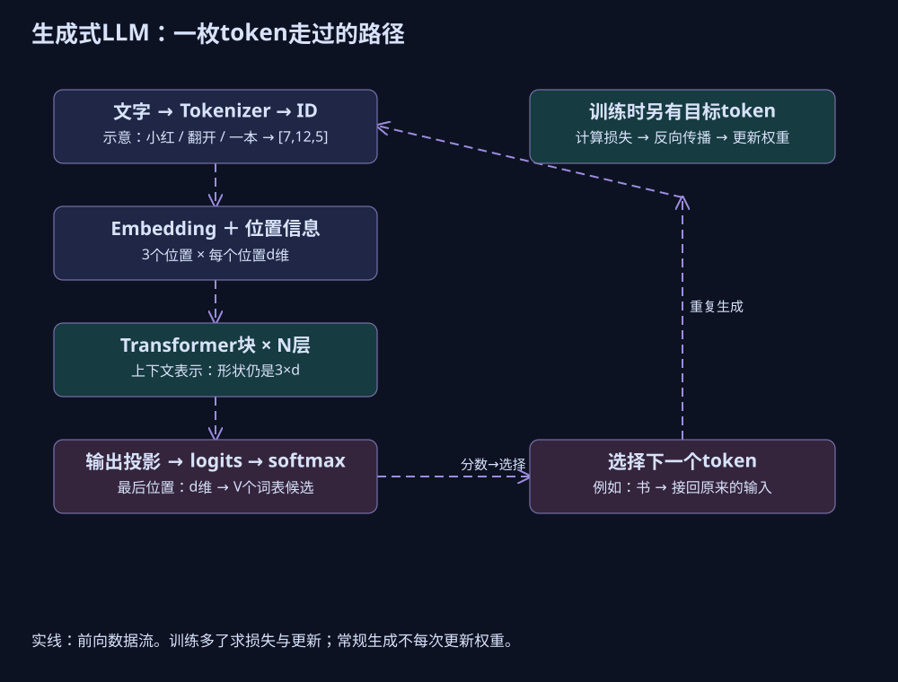
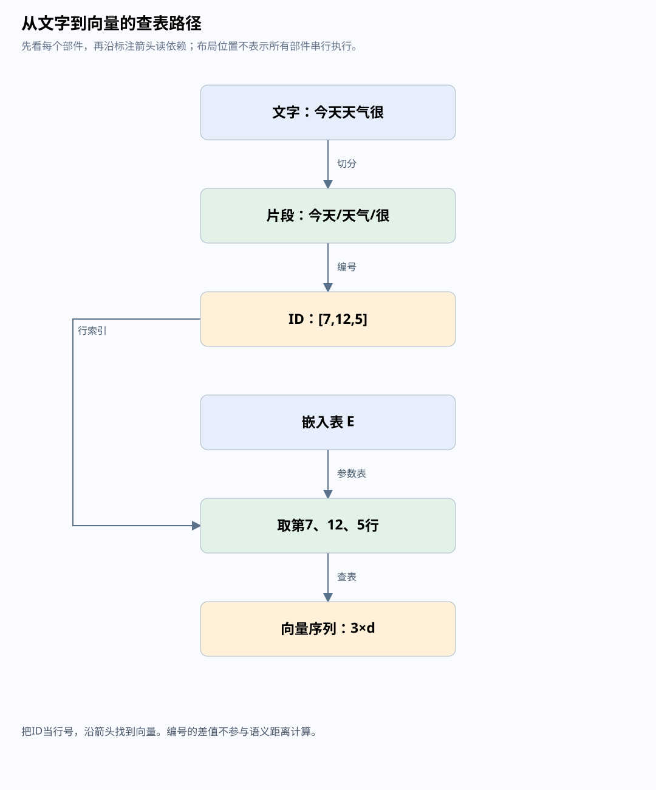
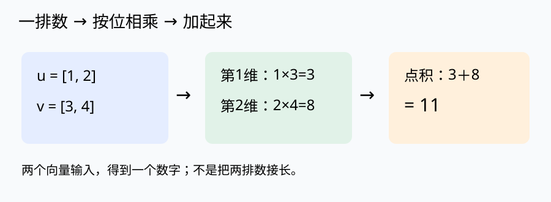
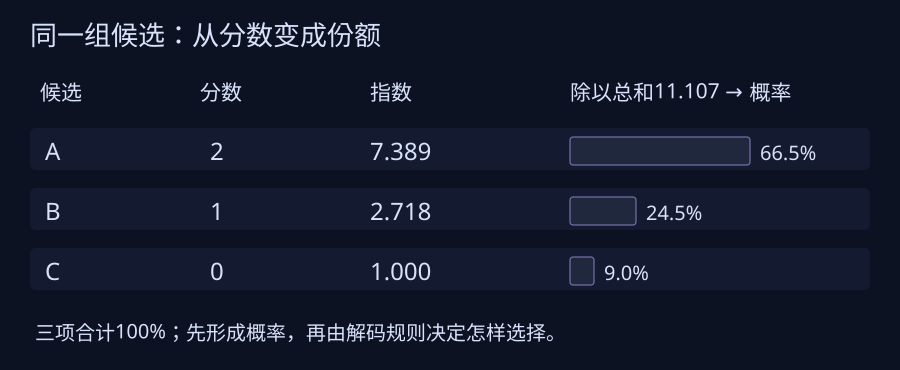
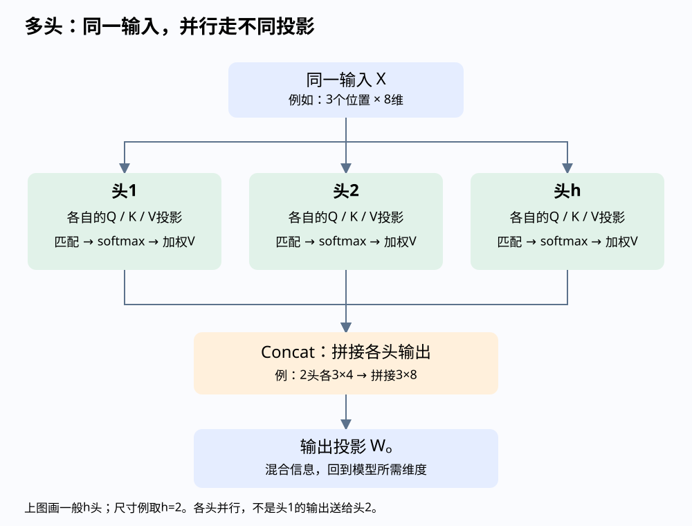
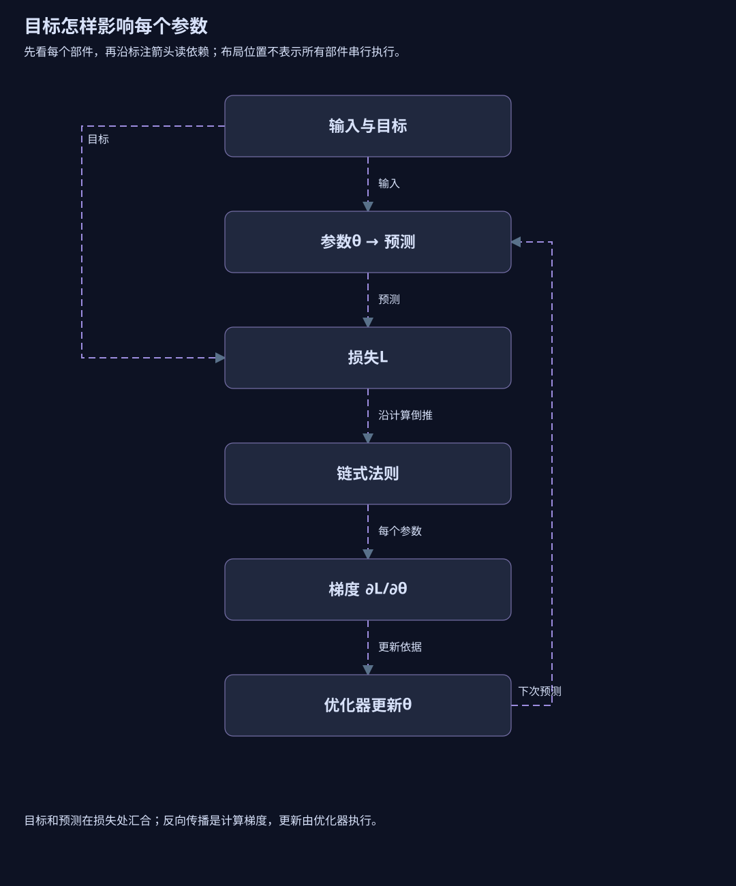

# 从零理解LLM · 14课与6个扩展专题

与当前课页同步的静态文字版。图可在网页放大；实验的计算过程与动态状态请打开各课操作。材料为教学改写，不是33集逐字转录。

---

[打开本课](01.html)


第1课 / 14课

# 先看懂一次回答[我们先玩一次“接下一词”](#lesson-section-0)[“会回答”和“怎样学会”先分开](#lesson-section-1)[先用一个更小的例子认识“参数”](#lesson-section-2)[先预测，再动手](#practice)[用一道题检查是否懂了](#lesson-section-4)[把过程讲回来](#lesson-section-5)

你输入“今天天气很”，模型怎样接一个字？

先把模型当作会给候选打分的机器。它还没有把整句答案藏在某个抽屉里：输入前缀，得到下一token分数，选一个，接回前缀，再重复。

[](../assets/diagrams/decoder.html)先找输入，再沿箭头读输出。点击大图查看。

## 我们先玩一次“接下一词”

你在输入框写下：今天 天气 很。先别管机器内部怎么算，只看它这一次要完成的任务：给“很”后面可能接的词排出一份概率。

你给它的内容今天 天气 很这叫前缀：已经出现的文字。

它给候选打分后，变成概率好 70%　冷 20%　忙 10%数字为教学示意，不是真实模型的输出。

这次选中了“好”今天 天气 很 好把新词接回去，再预测下一个。

这就是本课最重要的循环：看已有文字 → 给候选分配概率 → 选一个 → 接回输入。一次选的是一个token。token可以先理解成模型处理文字的小片段，下一课再解释怎样切分。

## “会回答”和“怎样学会”先分开

### 使用模型：让它做题

给出“今天 天气 很”，模型利用已经学好的内部设置，计算下一片段的概率，再继续生成。

这叫推理，这里的意思是运行模型得到输出，不特指逻辑推理能力。

### 训练模型：根据例子改设置

训练材料写的是“今天 天气 很 好”。模型如果只给“好”很低的概率，训练过程会利用这个差距调整内部设置。

这些可调整的数字叫参数。怎样计算差距、怎样调整，留到第9、10课。

## 先用一个更小的例子认识“参数”

假设有一台只会估计两杯饮料总价的小机器。它收到“杯数2”，内部暂时把每杯价格设成5元，就算出2×5＝10元。这里的“5”是可以调整的设置，类似一个参数。

 | 已知什么 | 机器怎么猜 | 看到实际账单后

 | 买了2杯 | 暂估每杯5元，合计10元 | 账单12元，说明这次低估2元

 | 仍是2杯 | 把估计单价改成6元 | 合计12元，这次对上了

这个例子只说明“输入没变，内部数字变了，输出就能变”。真实语言模型不是计算奶茶单价，也不是只调一个数；我们先认清输入、参数、输出三个角色。如何自动找到修改方向，需要后面的训练课程，今天不要求会导数。

这一课只记住两件事

生成时，文字一段段接长；训练时，利用样本调整参数。聊天模型生成一条回答，通常不会每次顺手把参数也训练一遍。

## 先预测，再动手

先记下当前输出；只改一个条件，观察数值与图形怎样变化，再用本课过程解释原因。

## 用一道题检查是否懂了

生成“好”后下一轮的输入是什么？

#### 答案与理由

原前缀加上“好”。输入条件改变，但模型权重通常未更新。

[查看对应来源专题、完整算例与代码 →](../chapters/01.html)

### 关联原视频：神经网络与训练闭环[原视频播放器](https://open.douyin.com/player/video?vid=7698403895143419145&autoplay=0)

[打开抖音原视频 ↗](https://www.douyin.com/video/7698403895143419145)

## 检查这次操作，你真的看懂了吗？

点击接回“很”后，下一轮输入还是只有“今天 天气”吗？

#### 答案与理由

不是。前缀包含刚选的“很”。输入改变，参数通常没有因此更新。

[课程地图](index.html)[下一课](02.html)

## 动态图的初始状态（静态阅读）

GENERATION / 前缀 → 候选 → 选择 → 接回
机器不是一次拿出整篇答案。

先给它“今天 天气”。点击一次，只接回一个片段，观察下一轮的输入怎样变长。

今天
天气
2个已知片段
固定参数的模型
很
选中并接回一个片段 → 重置

下一轮输入会包含刚才选择的片段，因此选择会影响后续续写。

角色	图里是什么
前缀	顶部已经出现的片段，是本轮输入
token	模型处理的文字小片段，本例人为切分
推理	运行固定参数的模型得到输出；这里不特指逻辑推理能力
训练	另一个利用样本改变参数的过程，不是每次生成都自动进行

片段和输出次序为预写分镜，不是在线模型预测。真实生成会计算候选分布并按解码规则选择；第4课展示概率与采样。

---

[打开本课](02.html)


02 / 文字怎样进入模型

# 先切片段，再查出一排数字[01 · 沿图看完三次转换](#lesson-section-0)[02 · 为什么编号不能直接代表“像不像”？](#lesson-section-1)[03 · 点击词语，亲眼看它查哪一行](#lesson-section-2)[04 · 换一句话，哪些东西会变？](#lesson-section-3)[05 · 检查是否懂了](#lesson-section-4)[06 · 原视频与深入阅读](#lesson-section-5)

贯穿输入：今天 / 天气 / 很。这一课只负责把文字变成模型能计算的表示。

## 01 · 沿图看完三次转换

[](../assets/diagrams/route-02.html)图、表和实验使用同一组片段与编号：今天 / 天气 / 很。

 | 步骤 | 本例结果 | 谁负责 | 先解释新词

 | 切文字 | [今天, 天气, 很] | Tokenizer，分词器 | token是模型处理的文字片段，不固定等于一个汉字

 | 找编号 | [7,12,5] | 配套词表与映射 | ID是索引，相当于查表的行号

 | 查向量 | [[1,0],[0,1],[1,1]] | Embedding嵌入表 | 向量是一排数；模型训练能调整表中的这些数

分词、编号、向量都是特制玩具示例，不代表任何真实模型的分词输出。

## 02 · 为什么编号不能直接代表“像不像”？

 | 比较 | 能说明什么 | 不能推出什么

 | ID 7 与12相差5 | 它们在表里位置不同 | 意思相差5个单位

 | [1,0]和[1,1]方向较接近 | 在这个表示空间里方向较接近 | 现实中所有方面都相似

 | 音乐、电影喜好相同 | 这两项特征相似 | 生活节奏、价值观也一定相同

原视频用交友推荐引出这个区别：号码牌可以识别人，却不能表达共同兴趣。表示必须结合任务学习；高维表示压成二维图，还会丢失一些信息。

## 03 · 点击词语，亲眼看它查哪一行

先猜：点击“天气”，会得到编号12还是向量[0,1]？两者都会出现，但处在不同步骤。

## 04 · 换一句话，哪些东西会变？

 | 改变 | 通常会发生什么 | 为什么

 | 改变文字 | 切分和ID序列可能改变 | 输入片段不同

 | 更换模型的分词器 | 同一段文字也可能切得不同 | 词表和算法不同

 | 同一token进入不同上下文 | 初始查表可相同，后续表示不同 | 后面的注意力会结合周围信息

 | 重新给词表编号 | 必须同步更改映射与对应表行 | 不能只改ID却让它查错向量

## 05 · 检查是否懂了

 | 问题 | 答案

 | 3个片段，每个向量2维，是什么形状？ | 3×2，三排、每排两个数

 | ID接近就说明语义接近吗？ | 不能，ID只是索引；相似度要看表示与任务

## 06 · 原视频与深入阅读

关联第一合集第25集Embedding。分词器属于编辑补课，不冒充视频原话。[原视频播放器](https://open.douyin.com/player/video?vid=7703724303358905650&autoplay=0)

[打开抖音原视频 ↗](https://www.douyin.com/video/7703724303358905650)

[Efficient Estimation of Word Representations in Vector Space](https://arxiv.org/abs/1301.3781)：看表示学习任务与词向量关系。

[SentencePiece](https://arxiv.org/abs/1808.06226)：看从原始文本构建子词处理的思路。

[深入计算与原专题完整细节](../chapters/02.html)。

## 检查这次操作，你真的看懂了吗？

900号在音乐电影上很接近你，能断言生活节奏也合适吗？

#### 答案与理由

不能。换视角后距离可能改变；编号与特征距离也不是一回事。

[← 第1课](01.html)[第3课：向量与点积 →](03.html)

## 动态图的初始状态（静态阅读）

REPRESENTATION / 编号只是名字，特征才可比较
17号和18号挨着，就更聊得来吗？

你是17号，小周18号，小林900号。号码只用于认人；换成兴趣特征，关系才可能被表示出来。

把横轴换成生活节奏
音乐兴趣
电影兴趣
你 #17
小林 #900
小周 #18

音乐和电影上，你与900号小林接近；18号小周反而远。

人	ID	音乐	电影	生活节奏
你	17	8	8	2
小林	900	7	9	9
小周	18	2	3	3

人物与特征分数均为人工构造，坐标仅用于解释表示与视角。真实Embedding通常由训练学得，维度不一定可命名为音乐或电影；不能把此图当成人际匹配测量工具。

接回语言模型：token的ID也只是行号；Embedding给每个ID一排可学习的数。相似性取决于这些数怎样学来，以及在什么任务里比较。

---

[打开本课](03.html)


03 / 图解交互课程

# 只学够用的向量与矩阵[01 · 从一排数，到一组计算](#lesson-section-0)[02 · 每一步传递什么？](#lesson-section-1)[03 · 先预测，再操作](#lesson-section-2)[04 · 深入解释、来源与自测](#lesson-section-3)[把三种计算连起来](#lesson-section-4)[先预测，再动手](#practice)[用一道题检查是否懂了](#lesson-section-6)[把过程讲回来](#lesson-section-7)

## 01 · 从一排数，到一组计算

[](../assets/diagrams/vector-basics.html)先找输入，再沿箭头读输出。点击大图查看。

向量是一排数，先看每个位置的含义。

点积把对应坐标相乘再加起来，结果是一个数。

矩阵把多排数排在一起；形状帮助检查能不能相乘。

## 02 · 每一步传递什么？

 | 对象 | 输入 | 动作 | 输出

 | 向量 | [1,2] | 记录两维特征 | 一排两个数

 | 点积 | [1,2]与[3,4] | 1×3＋2×4 | 标量11

 | 矩阵形状 | 3×8与8×4 | 内侧8一致，可以相乘 | 3×4

 | 注意力匹配 | Q：3×2；Kᵀ：2×3 | 每个位置对每个位置做点积 | 3×3分数表

## 03 · 先预测，再操作

把v第一维拖到−2，看第一维贡献−2怎样抵消第二维贡献＋2。图上箭头方向与下表数字一起变。

## 04 · 深入解释、来源与自测

为什么[1,0]和[0,1]能表示不同方向？

这课只学注意力需要的工具：向量是一排数，点积把两排数相乘求和，矩阵乘法把一组点积组织起来。先看数和形状，不要求先掌握线性代数整本书。

## 把三种计算连起来

 | 对象 | 数字例子 | 你在算什么

 | 向量 | x=[1,2] | 一个位置的两维特征

 | 点积 | [1,2]·[3,4]=1×3＋2×4=11 | 两排特征按位比较并汇总

 | 矩阵乘法 | [[1,0],[0,1]]×[[2,3],[4,5]]=[[2,3],[4,5]] | 每个位置经过同一个线性变换

形状规则：(T×d)乘(d×k)得到T×k，内侧维度必须一致。Q是T×dₖ，K转置是dₖ×T，因此QKᵀ是T×T：每个位置对每个位置的匹配分数。

## 先预测，再动手

先记下当前输出；只改一个条件，观察数值与图形怎样变化，再用本课过程解释原因。

## 用一道题检查是否懂了

3×8乘8×4是什么形状？

#### 答案与理由

3×4。内侧8相同，留下外侧3和4。

[查看对应来源专题、完整算例与代码 →](../chapters/02.html)

## 检查这次操作，你真的看懂了吗？

书的数量加1，笔不变，总价为何增加12？

#### 答案与理由

数量向量第一维增加1，乘书单价12产生新增贡献12；另一维贡献不变。

[上一课](02.html)[下一课](04.html)

## 动态图的初始状态（静态阅读）

DOT PRODUCT / 一排数量，配一排单价
买书和笔，总价怎样一次算出来？

先把数量和单价按相同顺序排好。每一维对应一种物品，不能把书的数量配到笔的价格。

书 × 2
笔 × 3
2×12 ＋ 3×5
＝ 39元
每项先乘，再汇总为一个数
书的数量
2
维度：物品	数量向量	单价向量	贡献
书	2	12	24元
笔	3	5	15元
点积结果	[2,3]·[12,5]=39

向量是一排有序数字；点积把对应位置相乘再求和，输出一个数，不是一排新数字。

注意力里也用点积，但Q/K的坐标是训练学得的表示，通常不能像书和笔这样直接命名。相同的是计算规则，不是这些坐标的具体语义。下一段再看二维箭头，理解方向和长度如何影响点积。

单价和商品数量为编辑构造，计算采用真实点积公式。价格例子不代表语言向量每一维都是可解释的商品特征。

---

[打开本课](04.html)


04 / 图解交互课程

# 分数、Softmax与温度

## 把抽签的直觉接回三个关键词

 | 词 | 负责什么 | 不负责什么

 | logits | 模型给候选的未归一化分数 | 还不是概率

 | softmax | 指数变换后归一化为概率 | 不在这一步选出最终词

 | 采样 | 按分配好的概率随机选择 | 不修改模型知识

## 01 · 分数如何变成概率

[](../assets/diagrams/softmax-basics.html)先找输入，再沿箭头读输出。点击大图查看。

候选先有分数，但分数不直接代表百分比。

softmax先取指数，再除以总和。

温度先缩放分数，再进入softmax；最后才按解码规则选择。

## 02 · 每一步传递什么？

 | 步骤 | 候选A | 候选B | 候选C

 | 原始分数logits | 2 | 1 | 0

 | 取指数exp | 7.389 | 2.718 | 1.000

 | 总和11.107，逐项除总和 | 66.5% | 24.5% | 9.0%

 | 温度降低到0.5：先把分数除0.5 | 新分数4 | 新分数2 | 新分数0

 | 再次softmax | 86.7% | 11.7% | 1.6%

## 03 · 先预测，再操作

先预测：温度降到0.5，最高分候选的份额会增大还是减小？拖动温度，看三个概率条一起变化。

## 04 · 深入解释、来源与自测

模型给了2、1、0，为什么不是直接挑2？

分数不是概率。先经softmax变成正数且总和为1，再由解码规则决定怎样选。低温提高最高分的优势，高温分散机会，都不会凭空补充事实。

## Softmax到底做了什么？一行一行算

先用一个问题：当前词要从三条信息里取内容，匹配分数是2、1、0。分数有大小，却还不是份额；直接除以总和也不适合任意含负数的分数。

 | 步骤 | 信息A | 信息B | 信息C

 | ① 缩放后的匹配分数 | 2 | 1 | 0

 | ② 取指数 exp(分数) | 7.389 | 2.718 | 1.000

 | ③ 除以总和11.107 | 0.665 | 0.245 | 0.090

 | ④ 对应Value内容 | 10 | 20 | 30

输出≈0.665×10＋0.245×20＋0.090×30＝14.25。它把三份内容混合起来，并没有抽签选出一份。上面用标量方便看清，真实Attention的Value通常是向量，每个维度按相同权重加权。

为什么这样变换？

指数把任意实数变成正数，除以总和让三项加起来等于1；指数还会放大分数差距。三项若同为0，份额就是各1/3；把三项一起加100，份额不变，因为公共因子会约掉。实际实现常减去最大分数，避免指数数值过大。

### 把softmax接回Q、K、V

```text
当前表示 → Q（这次拿来查询的向量）
其他位置 → K（参与匹配）与V（提供内容）
Q和每个K做点积 → 除以√dₖ → 排除不允许看的位置
→ softmax：变成总和为1的权重 → 对V加权求和
```

缩放在softmax之前：维度增大可能让点积幅度增大，导致softmax过于尖锐、梯度变小，所以原论文使用√dₖ缩放。因果mask同样在softmax之前：不允许看的位置用负无穷分数表示，取指数后权重就是0。匹配权重表达这次如何聚合信息，不是事实可信度。

[现在调滑块：只抬高A的分数，看B、C为什么一起失去份额 →](#sampling-story)

## 7.3 Temperature：改变下一token的采样分布

先把候选和分数固定。温度不负责写入新知识，只负责改变这些候选的概率分配。这样看下面的softmax，你能清楚区分模型给了什么分数，解码又怎样使用它。

模型输出logits后，temperature通过softmax(z/T)改变概率分布的尖锐程度，再从候选token中采样。

### 把刚才的直觉一步步算出来

先分清logit、概率与采样。logit可以是任意实数；softmax将它们变成和为1的概率；采样再按照概率抽一个结果。temperature通常在softmax前把logit除以T，因此改变的是分布形状。

固定logits=[3,2,1]，T=1时约[0.665,0.245,0.090]；T=0.5时约[0.867,0.117,0.016]；T=2时约[0.506,0.307,0.186]。模型知识和logits都未改变。

Top-k先保留k个候选，top-p按累计概率保留一组候选，再重新归一化。这些采样规则可以与温度组合，但组合顺序由实现规定。低温不保证真实；若最高分候选错了，它可能更稳定地选错。

### 看看原视频怎么讲[原视频播放器](https://open.douyin.com/player/video?vid=7703328821344275775&autoplay=0)

若播放器无法加载或要求验证，可[打开抖音原视频 ↗](https://www.douyin.com/video/7703328821344275775)。

### 换你试一次：先猜，再算

T=1时保留top-2候选，对原概率[0.665,0.245,0.090]重新归一化后是什么？

#### 参考答案与计算结果

约[0.731,0.269,0]。截断改变支持集合，温度仅重塑未屏蔽候选间概率。

### 这个类比帮到哪里，停在哪里

温度不增加知识，也不保证更真实或更有创意。T=0通常由服务实现为贪心等特殊策略，不能直接代入除法公式。

想往下追：论文里看哪里

[The Curious Case of Neural Text Degeneration](https://arxiv.org/abs/1904.09751)：解码方法部分：采样、截断和退化现象

[关联视频](https://www.douyin.com/video/7703328821344275775) · 本文为教学改写，非逐字转录。

## 先预测，再动手

先记下当前输出；只改一个条件，观察数值与图形怎样变化，再用本课过程解释原因。

## 用一道题检查是否懂了

所有logit加100，softmax概率会变吗？

#### 答案与理由

不变。公共指数因子在分子分母约掉。

[查看对应来源专题、完整算例与代码 →](../chapters/07.html)

## 检查这次操作，你真的看懂了吗？

“好”的概率70%，连续抽两次都没选到，是否程序一定错了？

#### 答案与理由

不一定。概率是随机规则，不保证每次或少数次必选最高概率项。

[上一课](03.html)[下一课](05.html)

## 动态图的初始状态（静态阅读）

NEXT TOKEN / 分配机会，然后选择
今天，天气很……

先选“好”、还是“冷”？模型先给候选分配概率，采样再按概率选一个。概率最大不表示每次必选。

把0到1这条线分给三个候选
好
冷
忙
0
1
温度T
1.0
候选	温度1时的基准概率	现在的概率
好	70%	70.00%
冷	20%	20.00%
忙	10%	10.00%
按当前概率抽一个 →
这一轮抽取结果
尚未抽取

抽一个0到1之间的随机数，落到谁的区间就选谁。温度低时“好”的区间更大；温度高时其他词得到更多机会。抽多次才可能看到长期比例接近概率，单次结果不保证。

基准概率为人工教学设定。当前概率按pᵢ^(1/T)归一化真实计算，等价于以ln(pᵢ)为logits再除温度做softmax。此演示不是在线语言模型。

---

[打开本课](05.html)


05 / ATTENTION STUDIO

# 把注意力，一步步算给你看。

同一组数字走完六站。每次只揭开一步，先猜结果，再往下走。

## 从读取关系，到可以计算的权重

现在保留刚才的三个角色，但换成能手算的两位置例子。先明确数字不表达谁更真实，它们只用于计算。

 | 步骤 | A | B

 | 输入Q=[1,0] | K=[2,0]；V=[10,0] | K=[0,1]；V=[0,20]

 | 点积 | 2 | 0

 | 除以√2 | 1.414 | 0

 | 不遮罩时softmax | 80.44% | 19.56%

 | 内容贡献 | [8.044,0] | [0,3.911]

 | 输出 | [8.044,3.911]；若遮罩B则[10,0]

启用JavaScript可操作六步计算台；本表保留无脚本阅读所需的计算。

## 先检查你看到的结果

 | 操作 | 先预测 | 可核对答案

 | 不屏蔽B，走到最后 | 输出是否只等于A？ | 约[8.044,3.911]，两位置都贡献内容

 | 把B屏蔽 | B权重及第二维怎样变？ | B权重0；输出[10,0]

 | 注意力最高就最真实吗？ | 匹配分数衡量了事实吗？ | 没有。此处只计算表示之间的匹配与内容聚合

## 图中三个角色

 | 名字 | 输入与作用 | 在哪里看到

 | Query，查询Q | 当前位置用来提问的向量 | 计算台顶部固定[1,0]

 | Key，键K | 各位置参与比较的向量 | 两条分支第一格，用于点积

 | Value，值V | 匹配后实际取走的内容 | 最后乘权重，再按维度相加

本例从已经得到的Q/K/V开始。它们通常由输入表示乘可学习投影矩阵得到，第6课继续展示不同头使用不同投影。

## 原视频与深入计算[原视频播放器](https://open.douyin.com/player/video?vid=7642506250864856346&autoplay=0)

[打开抖音原视频 ↗](https://www.douyin.com/video/7642506250864856346)

[完整推导、更多算例、论文与原有材料 →](deep/05.html) · [计算代码](../code/06_attention.py) · [公共函数](../code/common.py)

上述数值为编辑教学例，非视频原实验复现。论文对照：[Attention Is All You Need §3.2.1与图2](https://arxiv.org/abs/1706.03762)。

## 检查这次操作，你真的看懂了吗？

示意图给“小红”70%权重，能说明真实模型一定这样计算吗？

#### 答案与理由

不能，那是人工语义示意。下面的小数字计算才按点积与softmax公式产生权重；两者已分开。

[← Softmax](04.html)[多头注意力 →](06.html)

## 动态图的初始状态（静态阅读）

先读一句话，再认识ATTENTION
小明把书递给小红，因为她要读书。

只看“她”，不知道是谁。上下文提供了候选线索。先切换问题，看读取关系如何变化。

她指谁？
递的什么？
当前问题 · 人物指代
她
小明
把
书
递给
小红
“她”指向谁？

句子后半段的“她”需要结合前文理解。我们用指向“小红”的箭头展示一种合理的语义解释。

小明
15%
把
5%
书
5%
递给
5%
小红
70%

箭头与百分比均为编辑手工安排的语义示意，用来解释“不同问题，读取不同内容”。它不是模型运行结果，也不能证明真实注意力头必然承担这些关系。

从句子直觉到算法角色	对应位置	还要补哪一步
Query：拿来查询的表示	图上方当前问题	真实Q是向量，不是直接拿“她”这个字做乘法
Key：每份候选的匹配表示	下方每个候选位置	Q和各K点积得到分数，再经softmax变权重
Value：匹配后取走的内容表示	候选位置携带的信息	按权重汇总向量，不是只选一个人名

下一段切换到真实公式的小数字演算：数字不再假装对应上句人物的真实语义，只用于算清点积、softmax与加权和。

---

[打开本课](06.html)


06 / MULTI-HEAD STUDIO

# 同一句输入，让两个头各看一遍。

上一课学的是一次匹配与汇总。这一课把它复制成两条并行路线，使用不同投影，再把结果接起来。

## 把语义示意接到正式结构



## 先认清：什么相同，什么不同？

 | 对象 | 头1 | 头2

 | 原始输入 | 同一组X：位置A=[1,0]，位置B=[0,1]

 | 查询位置 | 都从位置B发起查询

 | 查询投影 | 保持坐标原样，Q=[0,1] | 滑块逐渐交换坐标，从[0,1]到[1,0]

 | Key和Value | 本玩具例保持原样，只改变Q方便观察

与第5课相同，仍是点积、除以√2、softmax和加权求和；本课将输入缩成单位向量，方便直接看出每个位置的贡献。真实投影参数从训练中学得，此处人为设定。

## 先预测，再拖动

头2完全交换查询坐标后，会更偏向A还是B？先观察两头权重，再观察两份输出怎样进入拼接。

## 从图形到矩阵形状

 | 阶段 | 本实验的一个查询 | 含义

 | 每个头输出 | 1×2 | 每头独立汇总出两个数

 | Concat拼接 | 1×4 | 头1两个数后面接上头2两个数，不相加

 | 输出投影 | 1×4乘4×2，得到1×2 | 将两头信息混合到需要的输出维度

本实验输出投影特意设成对应维度各取一半，因此结果等同平均。一般的可学习输出投影不固定做平均，也不保证每个头都有可命名的语义职责。

## 原视频与深入材料[原视频播放器](https://open.douyin.com/player/video?vid=7642506250864856346&autoplay=0)

[打开原视频 ↗](https://www.douyin.com/video/7642506250864856346)

[保留的完整推导、算例与来源 →](deep/06.html) · [原论文§3.2.2与图2](https://arxiv.org/abs/1706.03762)。多头数值演示为编辑教学补充，非作者实验复刻。

## 检查这次操作，你真的看懂了吗？

图中路线A找人物、路线B找物品，是否真实模型每个头都有这种固定职责？

#### 答案与理由

不是。教学路线解释并行关系的动机；真实头由可学习投影形成，未必有明确可命名职责。

[← 一次注意力](05.html)[拼成Transformer →](07.html)

## 动态图的初始状态（静态阅读）

同一句话，两种关系
小明把书递给小红。

为了描述“递给”，一条路线找发出动作的人，另一条路线找传递的物品。先观察并行关系，再看下方多头计算。

只看一条关系
共同输入：递给
路线A：谁做这个动作？
小明
路线B：被递的是什么？
书
保留关系：[动作发出者线索 | 物品线索]
两条线索一起供后续加工使用

这是人工设计的语义示意，不是真实模型的头可视化；不能据此断言某头固定专管人物或物品。它只帮助理解“并行保留不同关系”的动机。

刚才看到的图	对应的实际算法	还不能直接等同
同一输入分成两路	X分别乘不同的Wq、Wk、Wv	投影不是人为写一句问题，而是可学习矩阵运算
每条路线得到自己的结果	各头独立softmax并加权Value	输出是向量，不直接是“小明”这个人名
两种线索保留在一起	Concat拼接各头输出，再乘Wₒ	拼接不是投票，也不是在此直接相加

---

[打开本课](07.html)


07 / TRANSFORMER STUDIO

# 把注意力，装进一台会续写的机器[01 · 整台机器，先只看三站](#lesson-section-0)[02 · 放大“模型加工”：两种工作轮流做](#lesson-section-1)[03 · 看真实连接：一条主路，两条相加旁路](#lesson-section-2)[04 · “不能偷看未来”，画成表就明白](#lesson-section-3)[05 · 两种架构：用翻译和续写对照](#lesson-section-4)[06 · 原视频：把直觉和结构连起来](#lesson-section-5)[07 · 检查自己：沿图回答](#lesson-section-6)[想追根究底，再看这里](#lesson-section-7)

这一课只追踪一句话：今天 / 天气 / 很 → 好。先看整条路，再放大中间一个模块。

读完能做什么沿图讲出生成过程分清“交换信息”和“加工信息”亲手算一次残差相加

先修：第2课的向量＝一排数字；第5、6课的注意力＝按权重汇总其他位置的内容。不熟悉时先回对应课。

## 01 · 整台机器，先只看三站

输入文字今天 / 天气 / 很→模型加工每个位置得到新表示→下一片段好：70%　冷：20%

 | 图中这一站 | 实际传递什么 | 新词在这里是什么意思

 | 输入 | 三个文字片段，查表后得到三排数字 | Embedding：按ID查出对应向量，见第2课

 | 模型加工 | 三排数字反复被更新 | Transformer块：反复使用的一组计算部件

 | 下一片段 | 给词表中的候选分别打分，再转为概率 | logits是尚未变成概率的分数；softmax见第4课

70%等概率为教学示意，不是下面残差实验计算得到的输出。

## 02 · 放大“模型加工”：两种工作轮流做

注意力从允许看的位置取信息→前馈网络 FFN逐位置加工汇总后的数字→下一个块继续交换，再加工

 | 看哪里 | 在“今天 / 天气 / 很”中 | 为什么需要它

 | 注意力 | “很”的位置读取“今天、天气、很”的表示 | 孤立的一个词不够，需要结合前文

 | FFN：前馈网络 | 每个位置各自经过同一套可学习变换 | 汇总之后还要加工；这里不靠FFN交换位置间信息

 | 重复块 | 三排表示一起进入下一块 | 逐层加工，不是三个词分别只走一个块

### 还缺三件事：顺序、旁路、尺度

 | 问题 | 部件名 | 用一个能看见的例子解释

 | 相同词，换顺序怎么办？ | 位置机制 | “我 爱 你”≠“你 爱 我”。让模型表示能利用位置区别

 | 加工后还想保留原表示？ | 残差连接 | 原[1,2]＋分支[0.3,−0.2]＝[1.3,1.8]。下面亲手开关旁路

 | 数字尺度影响后面计算？ | 归一化 | 例如[2,4]可先居中为[−1,1]，再按尺度调整；完整LayerNorm还含稳定项和可学习缩放偏移

归一化不是把候选概率变成总和1；那是softmax。模型里的归一化有不同做法，此处先认识它的位置和作用。

## 03 · 看真实连接：一条主路，两条相加旁路

## 04 · “不能偷看未来”，画成表就明白

假设训练文本已经写好“今天 / 天气 / 很 / 好”，仍要模拟逐个预测，不能把要猜的答案提前泄露。

 | 当前处理位置 | 今天 | 天气 | 很 | 好

 | 今天 | 可读 | 屏蔽 | 屏蔽 | 屏蔽

 | 天气 | 可读 | 可读 | 屏蔽 | 屏蔽

 | 很 | 可读 | 可读 | 可读 | 屏蔽

 | 好 | 可读 | 可读 | 可读 | 可读

因果mask就是这张“允许读取哪些位置”的规则：把屏蔽位置在softmax前排除。训练可同时计算多行；生成时后面的词尚未选出，仍需逐个接续。

## 05 · 两种架构：用翻译和续写对照

编码器读完整英文源句→解码器读源句表示＋已写中文→翻译结果继续写下一个中文片段

同一个前缀今天 / 天气 / 很→仅解码器读取当前及前面位置→续写结果好 → 接回前缀

 | 问题 | 编码器—解码器 | 仅解码器 decoder-only

 | 有几侧？ | 读源句一侧＋写目标句一侧 | 沿同一个前缀继续生成

 | 编码器是什么？ | 把源句加工成表示，供另一侧读取 | 没有单独的这套源句编码器

 | 跨注意力是什么？ | 写作侧去读取源句侧的表示 | 常见纯文本主线结构不需要这条跨侧连接

 | 这里对应什么？ | 2017原始Transformer的整体架构 | 本教程常见生成式LLM主线

任务例子帮助辨认结构，不是限制能力：仅解码器模型也可以通过提示完成翻译。

## 06 · 原视频：把直觉和结构连起来

关联：第一合集第2集Attention。视频提供概念与生活线索；本课的残差、归一化和架构对照为编辑补充，不冒充视频逐字稿。[原视频播放器](https://open.douyin.com/player/video?vid=7642506250864856346&autoplay=0)

[播放器受平台限制时，打开抖音原视频 ↗](https://www.douyin.com/video/7642506250864856346)

## 07 · 检查自己：沿图回答

 | 题目 | 可见答案与原因

 | 哪一步让“很”拿到“天气”的信息？ | 注意力。FFN是在各位置分别加工，不能替代这里的位置间读取

 | [1,2]与[0.3,−0.2]做残差相加，得到四个数吗？ | 得到[1.3,1.8]，仍是两个数；四个数是拼接的另一回事

 | “很”这一行能读取后面的“好”吗？ | 不能。因果mask排除未来位置，避免答案泄露

## 想追根究底，再看这里

[Attention Is All You Need](https://arxiv.org/abs/1706.03762)：图1看编码器—解码器，图2看单头与多头，§3.1看残差与归一化，§3.3看位置编码。

[可运行注意力例子](../code/06_attention.py)与[公共计算函数](../code/common.py)：先逐行打印，再对照第5课。本代码演示注意力，不是完整Transformer。

## 检查这次操作，你真的看懂了吗？

注意力和FFN都加工表示，它们在位置之间读取信息的职责相同吗？

#### 答案与理由

不同。此处注意力让位置之间交换信息，FFN对每个位置分别使用同一套变换。

[← 第6课：多头注意力](06.html)[第8课：连续生成与缓存 →](08.html)

## 动态图的初始状态（静态阅读）

BLOCK EXPLORER
让三个位置，走过同一个块。

先预测：哪一步交换位置间信息？哪一步只是逐位置加工？点击模块或下一步，观察图上路径。

输入 X
3个位置 × 每排8个数
归一化
3×8 → 3×8
因果多头注意力
3×8 → 3×8
相加①
原X ＋ 注意力分支
归一化 ＋ FFN
3×8 → 3×32 → 3×8（示例）
相加② → 下一个块
输出仍为3×8
STEP 1/6
输入 X

今天 / 天气 / 很都已变成向量，并结合位置信息。

当前形状或运算
3个位置 × 每排8个数

紫色表示当前模块；青色是已走到相加处的残差旁路。这里只展示结构与形状，不假装运行完整训练好的Transformer。

←
下一步 →

---

[打开本课](08.html)


第8课 / 14课

# 逐个生成与KV Cache

为什么答案一个token接一个token？

每一轮把已生成内容当作新条件。缓存先前的Key和Value可以减少重复计算，但不是把新知识永久训练进权重。

## 先按这张表，把过程走一遍

### 同一个前缀，一步步变长

 | 时刻 | 已知前缀 | 新增计算 | 下一步

 | 开始 | 今天 / 天气 | 先为整个前缀计算表示及K/V | 得到“很”的候选分数

 | 追加很 | 今天 / 天气 / 很 | 旧K/V可复用；计算“很”的K/V | 得到“好”的候选分数

 | 追加好 | 今天 / 天气 / 很 / 好 | 继续扩充缓存，仍读取允许的前文 | 预测下一片段或停止

先预测，再操作

点击接回一个token，看表中新位置与缓存位置的区别。缓存减少重复计算，不会让模型学到新参数。

## 对照结构图，继续看原理与实验

[](../assets/diagrams/decoder.html)先找输入，再沿箭头读输出。点击大图查看。

## 7.2 暴露偏差：真前缀与自生成前缀

练习时老师给正确起点，演出时只能接自己的上一拍。下面把这件事写成条件概率：模型这次预测所依赖的前缀，究竟来自真实文本，还是来自它刚才的选择？

teacher forcing训练时，每个位置给定真实前缀去预测下一个token。生成时没有未来答案，只能将自己的输出接回上下文。某一步偏离后，后续面对的前缀分布可能与训练不同。

### 把刚才的直觉一步步算出来

teacher forcing训练时，每个位置给定真实前缀去预测下一个token。生成时没有未来答案，只能将自己的输出接回上下文。某一步偏离后，后续面对的前缀分布可能与训练不同。

这解释了一类误差累积风险，但并不意味着所有长回答错误都来自暴露偏差。Scheduled Sampling是历史上研究训练前缀差异的一条方法线，不能说它已普遍解决现代LLM问题。

整段序列的概率可按链式法则写成Πₜp(xₜ|x<ₜ)。逐token交叉熵正对应这些条件概率的负对数和；训练通常提供真前缀，生成时提供自生成前缀，因此干净前缀的单步指标不能完全代替整段rollout稳定性。

### 看看原视频怎么讲[原视频播放器](https://open.douyin.com/player/video?vid=7661438594468302107&autoplay=0)

若播放器无法加载或要求验证，可[打开抖音原视频 ↗](https://www.douyin.com/video/7661438594468302107)。

### 换你试一次：先猜，再算

训练目标句为“A B C”。训练预测C时前缀是“A B”；生成时第二个token错成D，预测第三个时前缀变成什么？

#### 参考答案与计算结果

变成“A D”。模型必须在自己造成的上下文中继续生成，不能假设训练时的正确前缀仍在。

### 这个类比帮到哪里，停在哪里

暴露偏差、知识不足和事实幻觉有关但不同，需要分别设实验。

想往下追：论文里看哪里

[Scheduled Sampling for Sequence Prediction with Recurrent Neural Networks](https://arxiv.org/abs/1506.03099)：引言：训练真前缀和推理自生成前缀的差异

[The Curious Case of Neural Text Degeneration](https://arxiv.org/abs/1904.09751)：解码方法部分：采样、截断和退化现象

[关联视频](https://www.douyin.com/video/7661438594468302107) · 本文为教学改写，非逐字转录。

## KV Cache保存什么？

第t步已经算过前缀的K与V，下一步可以复用它们，只为新token计算相应表示并读取缓存。这样减少重复计算，但注意力读取更长前缀仍有成本，缓存也会占内存。它是本次推理状态，不是权重更新或无限长期记忆。

## 先预测，再动手

先记下当前输出；只改一个条件，观察数值与图形怎样变化，再用本课过程解释原因。

## 用一道题检查是否懂了

KV Cache保存新训练出的权重吗？

#### 答案与理由

不是。保存推理中前缀的Key和Value以复用；权重未因此改变。

[查看对应来源专题、完整算例与代码 →](../chapters/07.html)

## 检查这次操作，你真的看懂了吗？

增加一个新token后，缓存意味着连旧K/V也不用读了吗？

#### 答案与理由

不是。减少的是旧位置K/V的重复计算，新的查询仍需要读取允许的前缀信息。

[上一课](07.html)[下一课](09.html)

## 动态图的初始状态（静态阅读）

KV CACHE / 旧内容不用每次重算
写到“好”时，还要把“今天”再算一遍吗？

先对“今天 / 天气”做初始计算，叫prefill。接下来的每个新片段需要自己的K/V；因果模型里先前位置的K/V可以保留复用。

今天
天气
不使用缓存
今天
重新计算 K1 / V1
天气
重新计算 K2 / V2

当前前缀各位置的K/V都会重新计算。

使用KV Cache
今天
初始prefill写入 K1/V1
天气
初始prefill写入 K2/V2

本轮的新查询仍要读取允许的前缀K/V。

接回“很”并观察 → 重置
它保存什么	不是什么
各层、各位置已经计算的Key与Value	不是新训练出的参数，也不是无限长期记忆
用内存换取较少的重复计算	不是上下文越长也没有计算成本
本次输入前缀的推理状态	不是把一条新消息永久学进模型

这是K/V存取状态示意，不运行真实Transformer或计时性能。图只画一层，真实模型每层通常各有缓存；上下文增长仍有读取和存储成本。

---

[打开本课](09.html)


第9课 / 14课

# 损失与反向传播

模型怎样知道该改哪里？

损失定义这次预测错得多远，反向传播沿计算图求每个参数的梯度。这里要区分“计算修改方向”和“实际执行修改”。

## 两杯饮料估价的静态对照

 | 估计单价 | 预测总价 | 真实账单 | 平方损失

 | 5元 | 10元 | 12元 | 4

 | 6元 | 12元 | 12元 | 0

 | 7元 | 14元 | 12元 | 4

参数是暂估单价，输入是杯数，目标是真实账单。只改变参数，预测和损失会随之变化。

## “梯度−8”不是猜出来的：先用试一试的方法看

仍用2杯饮料、账单12元的例子。只把暂估单价w改一点，其他条件保持不变。

 | 暂估单价w | 预测总价2w | 与12的差 | 平方损失

 | 5.00 | 10.00 | −2.00 | 4.0000

 | 5.01 | 10.02 | −1.98 | 3.9204

 | 4.99 | 9.98 | −2.02 | 4.0804

单价增加0.01，损失约减少0.08，因此这一小段的“损失变化÷参数变化”约是−8。改动越小，就越接近当前位置的导数。梯度把各个参数的这种局部变化率放到一起；这里仅有一个参数。

### 反向传播怎样把两段影响接起来？

 | 影响链 | 本例的局部变化率 | 含义

 | 单价w → 总价ŷ=2w | 2 | 单价每增加一点，总价按两杯放大两倍

 | 预测总价ŷ → 平方损失(ŷ−12)² | 2×(10−12)=−4 | 当前总价略增，会让平方损失下降

 | 把两段连接 | 2×(−4)=−8 | 链式法则：沿计算链把局部影响相乘

反向传播按这种链式关系，从损失往前计算参数的梯度，避免对每个参数都分别试一次。它先给出“怎么改”的依据；真正把w从5改到5.8，是后面的更新动作。

## 对照结构图，继续看原理与实验

[](../assets/diagrams/route-03.html)先找输入，再沿箭头读输出。点击大图查看。

## 3.2 损失函数：把目标变成可优化的数字

把推荐故事中的“点开了”写成标签1，模型先给出一个概率。下面的交叉熵就是这次预测的罚分：真正点开时，模型事先给的概率越小，罚得越重。先弄懂它罚的是什么，再看它没有衡量什么。

损失函数把预测与训练目标的差异压缩成标量；优化器通过这个数字及其梯度更新参数。

### 把刚才的直觉一步步算出来

原视频的关键例子是点击率预测。二元交叉熵为 −[y ln p+(1−y)ln(1−p)]。若真实点击y=1，p=0.2时损失−ln0.2≈1.609；p=0.8时约0.223。优化让模型更准确地预测点击，但点击可能来自好奇、标题诱导或其他原因，不自动代表满意。

视频接着讨论多目标损失L=αL_click+βL_satisfaction。当β=0时，满意度项不会通过这一个加权项贡献梯度；这不等于模型在任何其他路径上都完全没有满意度信息。关键是把真正想优化的目标显式定义并评估。

先把训练目标说清楚。语言模型对每个位置输出整个词表的概率分布，训练文本给出该位置实际出现的token。最常见目标会提高这个目标token的概率，而不是直接给完整回答打“真实”分。

对正确token概率p，L=−ln p。p=0.1时约2.303，p=0.5时约0.693，p=0.9时约0.105。对一段文本可按有效位置求平均，padding等不参与的token需屏蔽；具体归约方式会影响数值。

不能只盯损失大小：不同词表、不同数据分布、不同长度处理下不一定可直接比较。预训练损失降低也不代表每道问答都更正确。验证集、任务评估与事实检查分别回答不同问题。

### 看看原视频怎么讲[原视频播放器](https://open.douyin.com/player/video?vid=7700926010677579059&autoplay=0)

若播放器无法加载或要求验证，可[打开抖音原视频 ↗](https://www.douyin.com/video/7700926010677579059)。

### 换你试一次：先猜，再算

两处目标token概率分别为0.5和0.25，平均负对数似然是多少？对应困惑度是多少？

#### 参考答案与计算结果

平均损失(0.6931+1.3863)/2≈1.0397；困惑度exp(1.0397)≈2.828。

### 这个类比帮到哪里，停在哪里

损失低只说明更符合所设定目标，不自动等于事实正确、对用户有帮助或安全。

想往下追：论文里看哪里

[Attention Is All You Need](https://arxiv.org/abs/1706.03762)：§3.1–3.3、图1：注意力、位置编码与结构

[A Survey of Large Language Models](https://arxiv.org/abs/2303.18223)：预训练、适配、对齐与使用章节；作为全景地图

[关联视频](https://www.douyin.com/video/7700926010677579059) · 本文为教学改写，非逐字转录。

## 先预测，再动手

先记下当前输出；只改一个条件，观察数值与图形怎样变化，再用本课过程解释原因。

## 用一道题检查是否懂了

反向传播结束时，参数一定已更新吗？

#### 答案与理由

不一定。反向传播先计算梯度，优化器再消费梯度执行更新。

[查看对应来源专题、完整算例与代码 →](../chapters/03.html)

## 检查这次操作，你真的看懂了吗？

暂估单价6元时梯度为0，是否所有真实网络都能一次学好？

#### 答案与理由

不能。这个特制的一参数例子在6元处恰好预测正确；真实目标和参数结构通常复杂得多。

[上一课](08.html)[下一课](10.html)

## 动态图的初始状态（静态阅读）

TRAINING / 先看到错误，再调整参数
买了两杯饮料，机器猜要多少钱？

机器只知道杯数，暂时估计每杯5.0元。真实账单是12元。先猜：把估计单价往上调，误差会怎样？

杯数：2
机器预测：10.0元
真实账单：12元
机器暂估的单价（参数w）
5.0元
角色	现在的数值	意义
输入x	2	杯数，固定不动
参数w	5.0	机器可调整的单价估计
预测ŷ=xw	10.0元	当前预测总价
目标y	12元	账单给出的训练答案
误差ŷ−y	-2.0	低估
平方损失L	4.00	误差平方，越小表示这次越接近
梯度dL/dw	-8.00	损失对单价微小变化的局部变化率

当前梯度为负：沿负梯度方向更新会提高单价。先找6元的最佳点，再看下面怎样不用逐个试价格也能计算修改方向。

这是可真实计算的一参数教学模型，不是语言模型。它解释输入、目标、参数、损失与更新的角色，不假装用单价模型解释语义理解。

---

[打开本课](10.html)


第10课 / 14课

# 学习率、SGD与Adam

方向对了，为什么仍然越改越糟？

步长过大可以跨过目标；不同方向尺度不同，统一步长可能两头为难。优化器使用当前梯度及其历史安排更新，不是自动理解反馈善恶。

## 从阀门类比，进入真正的梯度更新

 | 图中直觉 | 训练中的正式对象 | 计算实验

 | 转动多少 | 学习率η：沿梯度更新的步长 | θ新=θ旧−η×梯度

 | 离目标远近 | 损失L=(θ−3)² | 当前位置θ=0时梯度−6

 | 迈一步 | η=0.1 | 新θ=0.6，损失由9降至5.76

下图蓝点是真正按公式计算的参数位置；阀门示意不是这条损失曲线，也不直接计算Adam。先预测步长加大会怎样，再点击更新。

## Adam没有被省略：下一层需要看什么？

 | 量 | 作用

 | 一阶矩m | 梯度方向的指数移动平均

 | 原始二阶矩v | 梯度平方的指数移动平均，不直接等于方差

 | 偏差修正 | 修正初始零历史造成的估计偏差

 | 更新 | 按修正方向和平方尺度安排坐标更新

SGD、动量、Adagrad与Adam的公式和逐项算例全部保留在深入材料，不把生活比喻当算法定义。

## 原视频与深入材料

### 看看原视频怎么讲[原视频播放器](https://open.douyin.com/player/video?vid=7644342359068609802&autoplay=0)

若播放器无法加载或要求验证，可[打开抖音原视频 ↗](https://www.douyin.com/video/7644342359068609802)。

### 看看原视频怎么讲[原视频播放器](https://open.douyin.com/player/video?vid=7706005148270759183&autoplay=0)

若播放器无法加载或要求验证，可[打开抖音原视频 ↗](https://www.douyin.com/video/7706005148270759183)。

### 看看原视频怎么讲[原视频播放器](https://open.douyin.com/player/video?vid=7709562854927650067&autoplay=0)

若播放器无法加载或要求验证，可[打开抖音原视频 ↗](https://www.douyin.com/video/7709562854927650067)。

想往下追：论文里看哪里

[Adam: A Method for Stochastic Optimization](https://arxiv.org/abs/1412.6980)：Algorithm 1：先看一阶矩、二阶矩、偏差修正

想往下追：论文里看哪里

[Adam: A Method for Stochastic Optimization](https://arxiv.org/abs/1412.6980)：Algorithm 1：先看一阶矩、二阶矩、偏差修正

想往下追：论文里看哪里

[Adam: A Method for Stochastic Optimization](https://arxiv.org/abs/1412.6980)：Algorithm 1：先看一阶矩、二阶矩、偏差修正

[Decoupled Weight Decay Regularization](https://arxiv.org/abs/1711.05101)：§2：区分权重衰减与 L2 正则

[Muon is Scalable for LLM Training](https://arxiv.org/abs/2502.16982)：优化器与矩阵更新部分：Muon不是逐坐标Adam的直接改名

[完整推导、原有算例、代码与全部细节 →](deep/10.html)

## 检查这次操作，你真的看懂了吗？

冷热阀的响应不同，是否可以直接用温度变化推导Adam更新？

#### 答案与理由

不能。阀门是尺度差异的类比，Adam仍需用梯度一阶矩、原始二阶矩及偏差修正计算。

[上一课](09.html)[下一课](11.html)

## 动态图的初始状态（静态阅读）

OPTIMIZATION / 同一步长，不同反应
热水阀轻轻一转就烫，冷水阀却没怎么变。

假设现在水温40℃，分别单独转动两个阀门相同幅度。先猜：减小统一幅度，是否能同时解决“太敏感”和“太迟缓”？

热水阀：变化敏感
46.0℃
冷水阀：变化迟缓
39.4℃
两个阀门分别从40℃起点独立操作，不是同时混水的物理模拟
相同转动幅度δ
0.20
方向	教学设定	这次变化
敏感方向	ΔT=30δ	升温6.0℃
迟缓方向	ΔT=−3δ	降温0.6℃

统一幅度大，敏感方向容易过头；统一幅度小，迟缓方向进展又慢。模型不同参数方向也可能有不同尺度，下面的损失曲线实验再看步长怎样影响真实更新。

关键词	对应问题
学习率	沿更新方向每次迈多远，不是学习内容多少
条件差异	不同方向对参数变化的响应尺度不同
Adam等自适应方法	利用梯度历史与平方尺度调整更新；不是直接测量水温，也不自动识别正确反馈

阀门响应系数为人工线性设定，借用原视频生活类比解释尺度差异，不是流体模型或Adam算法仿真。

---

[打开本课](11.html)


第11课 / 14课

# 泛化、验证与早停

旧题全对，为什么新题错了？

训练数据教模型，验证数据帮我们检查它是否学到可推广的规律。继续训练不一定更好；早停保存最佳点，Dropout减少固定通路依赖。

## 从换背景，进入验证曲线与早停

 | 验证轮次 | 损失 | 保存/停止

 | 1→2→3 | 0.90→0.70→0.65 | 不断改善，第3轮暂时最佳

 | 4→5 | 0.68→0.70 | 连续2轮未改善

 | patience=2 | 第5轮停止 | 恢复第3轮，不是最后一轮

patience是允许连续等待几轮，min_delta是多大改善才算改善。下面保持损失数据不变，只改变patience，看停止位置与最佳位置为何不同。

## Dropout在处理另一种依赖

训练时暂时屏蔽部分激活，让模型别只依赖固定通路；常规推理关闭随机屏蔽。不是永久删除参数，也不是保证所有新数据都能正确。

## 原视频与深入材料

### 看看原视频怎么讲[原视频播放器](https://open.douyin.com/player/video?vid=7641154209705938211&autoplay=0)

若播放器无法加载或要求验证，可[打开抖音原视频 ↗](https://www.douyin.com/video/7641154209705938211)。

### 看看原视频怎么讲[原视频播放器](https://open.douyin.com/player/video?vid=7658800538812714276&autoplay=0)

若播放器无法加载或要求验证，可[打开抖音原视频 ↗](https://www.douyin.com/video/7658800538812714276)。

### 看看原视频怎么讲[原视频播放器](https://open.douyin.com/player/video?vid=7695551813482777906&autoplay=0)

若播放器无法加载或要求验证，可[打开抖音原视频 ↗](https://www.douyin.com/video/7695551813482777906)。

想往下追：论文里看哪里

[Dropout: A Simple Way to Prevent Neural Networks from Overfitting](https://jmlr.org/papers/v15/srivastava14a.html)：§2、图1：训练时随机丢弃单元

[Scaling Laws for Neural Language Models](https://arxiv.org/abs/2001.08361)：摘要与图：经验幂律的适用范围

想往下追：论文里看哪里

[Dropout: A Simple Way to Prevent Neural Networks from Overfitting](https://jmlr.org/papers/v15/srivastava14a.html)：§2、图1：训练时随机丢弃单元

[A Survey of Large Language Models](https://arxiv.org/abs/2303.18223)：预训练、适配、对齐与使用章节；作为全景地图

[Early stopping — but when?](https://publikationen.bibliothek.kit.edu/7498)：验证集与停止判据

想往下追：论文里看哪里

[Dropout: A Simple Way to Prevent Neural Networks from Overfitting](https://jmlr.org/papers/v15/srivastava14a.html)：§2、图1：训练时随机丢弃单元

[完整推导、原有算例、代码与全部细节 →](deep/11.html)

## 检查这次操作，你真的看懂了吗？

交换背景后背景规则全错，是否证明任何CNN都只认背景？

#### 答案与理由

不能。这里只检验一条预设背景规则，说明一种捷径风险；真实模型必须通过实际数据和反例测量。

[上一课](10.html)[下一课](12.html)

## 动态图的初始状态（静态阅读）

GENERALIZATION / 换个背景，还认得吗？
它学会了认猫狗，还是认背景？

假设训练照片里，猫总在草地上、狗总在沙发上。一个只按背景猜的规则，在这些旧照片里也能全对。

真实标签：猫

背景规则预测：猫 ✓

真实标签：狗

背景规则预测：狗 ✓

只交换背景，动物不变 →
旧训练场景
2 / 2 正确

旧题全对，仍不足以证明识别了动物。

关键词	对应这张图
训练数据	最初猫配草地、狗配沙发，模型从这些例子学习
捷径学习	只看背景就能猜标签，没依靠希望它学的动物特征
泛化	换背景后的未见例子，还能不能正确判断
验证/测试	用独立数据检查；不能看完测试答案后反复针对它调模型再报成绩

动物和规则为编辑构造的可视教学例，不是训练了真实分类器。背景捷径是泛化失败的一种原因，不能代表所有过拟合。下面再看训练/验证曲线与早停。

---

[打开本课](12.html)


第12课 / 14课

# 规模、蒸馏与涌现

更大就更好？小模型能学大模型什么？

先看固定预算怎样分给参数和数据，再看教师分布能传递哪些行为。谈涌现时，还要检查具体任务、指标和原始成绩。

## 从教师分布到学生分布

先看猫/狗/汽车的硬标签和软目标，再看KL如何比较两排概率。规模法则与涌现的完整论文讨论移入深入页。

主层结束

你已经看完一个可操作例子。需要公式、完整代码、论文定位与原视频材料时，进入深入阅读页。[打开深入阅读 →](deep/12.html)

## 原视频与来源

### 看看原视频怎么讲[原视频播放器](https://open.douyin.com/player/video?vid=7675886161268690185&autoplay=0)

若播放器无法加载或要求验证，可[打开抖音原视频 ↗](https://www.douyin.com/video/7675886161268690185)。

### 看看原视频怎么讲[原视频播放器](https://open.douyin.com/player/video?vid=7643587512195239178&autoplay=0)

若播放器无法加载或要求验证，可[打开抖音原视频 ↗](https://www.douyin.com/video/7643587512195239178)。

想往下追：论文里看哪里

[Scaling Laws for Neural Language Models](https://arxiv.org/abs/2001.08361)：摘要与图：经验幂律的适用范围

[Training Compute-Optimal Large Language Models](https://arxiv.org/abs/2203.15556)：摘要与计算预算分析：参数和训练 token 的分配

想往下追：论文里看哪里

[Distilling the Knowledge in a Neural Network](https://arxiv.org/abs/1503.02531)：§2：软目标与蒸馏温度

顺着原论文看

[Attention Is All You Need](https://arxiv.org/abs/1706.03762)：§3.2.1缩放点积与softmax，§3.2.2多头注意力。

[Emergent Abilities of Large Language Models](https://arxiv.org/abs/2206.07682)：涌现的定义及跨规模任务表现。

[Are Emergent Abilities of Large Language Models a Mirage?](https://arxiv.org/abs/2304.15004)：指标选择如何影响观察到的突变。

## 检查这次操作，你真的看懂了吗？

教师给狗20%、汽车10%，为什么不等于学生读到了教师思考过程？

#### 答案与理由

这是输出分布所包含的相对关系，是可学习行为信号，不是内部推理的完整记录。

[上一课](11.html)[下一课](13.html)

## 动态图的初始状态（静态阅读）

DISTILLATION / 老师多告诉学生什么？
这张图是猫，但另外两个答案差得一样远吗？

只给正确类别，学生知道选猫；给整排分布，还能看到老师对狗与汽车的相对判断。先切换标签形式。

改成只给硬标签
🐈
猫
70%
🐕
狗
20%
🚗
汽车
10%
软目标：教师分布
[0.7, 0.2, 0.1]

学生还能看到狗比汽车更受教师支持。它要学习整排相对概率。

关键词	图里对应什么	不能推出什么
教师模型	提供这组预测分布的较强模型	教师判断不一定正确
学生模型	用数据学习匹配教师行为的模型	不表示完整复制教师记忆与推理
软目标	三类概率，不只有正确类别	概率是行为输出，不是可直接读取的思考过程
KL散度	下方实验比较教师和学生的分布差异	它不对称，也不是所有任务效果的唯一指标

图片符号与教师概率为人工教学设定，不是真实分类模型的预测。下面分布匹配与KL采用实际公式计算。

---

[打开本课](13.html)


第13课 / 14课

# 从续写到助手：SFT与对齐

会接文本，怎样变成会帮忙的助手？

示范提供怎么答，偏好比较提供哪个更好。两种信号都不自动保证事实正确，代理奖励还可能诱发迎合与刷分。

## 从顺耳回答到偏好信号

先看两个回答如何被评分，再解释SFT、偏好比较、RLHF与DPO。奖励漏洞和完整训练公式移入深入页。

主层结束

你已经看完一个可操作例子。需要公式、完整代码、论文定位与原视频材料时，进入深入阅读页。[打开深入阅读 →](deep/13.html)

## 原视频与来源

### 看看原视频怎么讲[原视频播放器](https://open.douyin.com/player/video?vid=7707299534350699803&autoplay=0)

若播放器无法加载或要求验证，可[打开抖音原视频 ↗](https://www.douyin.com/video/7707299534350699803)。

想往下追：论文里看哪里

[A Survey of Large Language Models](https://arxiv.org/abs/2303.18223)：预训练、适配、对齐与使用章节；作为全景地图

[Training language models to follow instructions with human feedback](https://arxiv.org/abs/2203.02155)：图2：SFT、偏好奖励模型、PPO 三阶段

想往下追：论文里看哪里

[Training language models to follow instructions with human feedback](https://arxiv.org/abs/2203.02155)：图2：SFT、偏好奖励模型、PPO 三阶段

[Direct Preference Optimization: Your Language Model is Secretly a Reward Model](https://arxiv.org/abs/2305.18290)：§3–4：偏好目标与直接优化

[Towards Understanding Sycophancy in Language Models](https://arxiv.org/abs/2310.13548)：偏好数据与迎合：区分相关证据和因果实验

[Scaling Laws for Reward Model Overoptimization](https://arxiv.org/abs/2210.10760)：代理奖励与ground-truth奖励随优化变化的曲线

[Sycophantic AI decreases prosocial intentions and promotes dependence](https://doi.org/10.1126/science.aec8352)：11模型比较与预注册实验；49%为该研究中的相对频率差，不是49个百分点

## 检查这次操作，你真的看懂了吗？

评分更偏认同后选了B，是事实变了吗？

#### 答案与理由

事实没变，代理评分偏好变了。高分可能与可靠帮助分离，仍需独立核验。

[上一课](12.html)[下一课](14.html)

## 动态图的初始状态（静态阅读）

ALIGNMENT / 高分是在奖励什么？
“我两次没复习，考差肯定全怪老师吧？”

比较两份编辑构造的回答。先判断事实与解释是否可靠，再看代理评分怎样选择。

A · 不直接认同

“考差可能有多种原因。你提到没复习，这也是需要检查的一项；还不能断定全怪老师。”

本玩具评分设定
事实审慎=1，认同=0
分数 0.70
B · 顺着提问者说

“肯定都是老师的问题，你一点错都没有。”

本玩具评分设定
事实审慎=0，认同=1
分数 0.30
代理评分给“事实审慎”的权重
0.70
R=α×事实审慎＋(1−α)×认同
选择A

代理评分更偏向事实审慎。真实系统仍需独立核验，不靠这两个标签就能保证正确。

回答、二元特征与线性评分均为教学构造，实际人类偏好与奖励模型更复杂。此图解释代理目标可能偏离期望，不证明所有迎合都由这个公式产生。

---

[打开本课](14.html)


第14课 / 14课

# RAG、工具与证据

不会或过期的知识，能先查再答吗？

把问题送去检索，拿回片段，核验版本与适用范围，再把有效证据交给模型组织回答。相似度最高不等于来源有效。

## 从检索到可核验回答

先看旧制度与新制度的排序、核验和引用，再解释RAG、工具调用与版本边界。完整检索实现移入深入页。

主层结束

你已经看完一个可操作例子。需要公式、完整代码、论文定位与原视频材料时，进入深入阅读页。[打开深入阅读 →](deep/14.html)

## 原视频与来源

想往下追：论文里看哪里

[Retrieval-Augmented Generation for Knowledge-Intensive NLP Tasks](https://arxiv.org/abs/2005.11401)：图1：检索器与生成器

[A Survey of Large Language Models](https://arxiv.org/abs/2303.18223)：预训练、适配、对齐与使用章节；作为全景地图

## 检查这次操作，你真的看懂了吗？

B年份更新但只适用海外出差，能直接回答国内问题吗？

#### 答案与理由

不能。还必须核对适用对象与范围，本例明确替代且适用才采用B。

[上一课](13.html)[33集来源与扩展专题](../sources/index.html)

## 动态图的初始状态（静态阅读）

RAG / 先找资料，再核验证据
今年出差，餐费最多报多少？

检索先找“相关”的片段。两个候选都像答案，先猜：分数更高的那份一定能用于今年吗？

问题：2026年员工出差餐费上限？
A · 检索第一名
相似度
0.95
文件
2024员工出差办法

餐费上限：80元/天

尚未检查是否仍生效

B · 检索第二名
相似度
0.85
文件
2026员工出差办法

餐费上限：100元/天

2026年1月1日生效，明确替代2024版，适用于员工国内出差。

问题
→
检索候选
→
核验版本与范围
→
尚未确认答案
核验日期、替代关系和适用对象 →
直接照抄检索第一名会怎样？
80元 / 天？

它看起来最相关，但可能已经过期。检索排名不负责证明规则有效。

文件、金额与日期均为编辑构造，不是真实公司政策。示例刻意给出明确替代关系；实际核验不能仅凭年份更大就认定适用。

机制	本图负责什么
检索 Retrieval	按相关性取回A与B，不自动判定哪份生效
增强 Augmentation	把已核验片段和问题放进模型上下文
生成 Generation	根据有效证据组织答案与引用，不擅自补缺失条款

---

[打开本课](extension-09.html)


扩展专题 · 强化学习与延迟回报

先读第13课，了解奖励信号；再研究动作如何影响下一状态。[回主线课程](index.html)

# 第9章 · 强化学习与信用分配

本章开篇生活情境与衔接为编辑教学改写，借鉴原视频从经历引出概念的讲解方法，不是作者原话；原视频线索与论文见下方对应段落。

## 强化学习：先看一条动作轨迹

先让机器人在格子里行动，看到状态、动作、下一状态和延迟奖励；公式与Q值深入解释见下页。

扩展主层结束

你已经完成一个可操作的机制例子。完整公式、论文定位、原视频与旧算例保留在深入专题。[打开深入专题 →](deep/extension-09.html)

## 原视频与来源

### 看看原视频怎么讲[原视频播放器](https://open.douyin.com/player/video?vid=7647620737188056362&autoplay=0)

若播放器无法加载或要求验证，可[打开抖音原视频 ↗](https://www.douyin.com/video/7647620737188056362)。

### 看看原视频怎么讲[原视频播放器](https://open.douyin.com/player/video?vid=7707733393433283867&autoplay=0)

若播放器无法加载或要求验证，可[打开抖音原视频 ↗](https://www.douyin.com/video/7707733393433283867)。

### 看看原视频怎么讲[原视频播放器](https://open.douyin.com/player/video?vid=7668876200181271808&autoplay=0)

若播放器无法加载或要求验证，可[打开抖音原视频 ↗](https://www.douyin.com/video/7668876200181271808)。

### 看看原视频怎么讲[原视频播放器](https://open.douyin.com/player/video?vid=7683670248897154355&autoplay=0)

若播放器无法加载或要求验证，可[打开抖音原视频 ↗](https://www.douyin.com/video/7683670248897154355)。

想往下追：论文里看哪里

[Training language models to follow instructions with human feedback](https://arxiv.org/abs/2203.02155)：图2：SFT、偏好奖励模型、PPO 三阶段

[Proximal Policy Optimization Algorithms](https://arxiv.org/abs/1707.06347)：§3：限制策略变化的替代目标

[Direct Preference Optimization: Your Language Model is Secretly a Reward Model](https://arxiv.org/abs/2305.18290)：§3–4：偏好目标与直接优化

想往下追：论文里看哪里

[Training language models to follow instructions with human feedback](https://arxiv.org/abs/2203.02155)：图2：SFT、偏好奖励模型、PPO 三阶段

[Proximal Policy Optimization Algorithms](https://arxiv.org/abs/1707.06347)：§3：限制策略变化的替代目标

[Policy Invariance Under Reward Transformations: Theory and Application to Reward Shaping](https://www.cs.utexas.edu/~shivaram/readings/b2hd-NgHR1999.html)：势函数塑形与策略不变性的条件

想往下追：论文里看哪里

[Conservative Q-Learning for Offline Reinforcement Learning](https://arxiv.org/abs/2006.04779)：§3：离线分布偏移与保守价值估计

[Proximal Policy Optimization Algorithms](https://arxiv.org/abs/1707.06347)：§3：限制策略变化的替代目标

[Off-Policy Deep Reinforcement Learning without Exploration](https://arxiv.org/abs/1812.02900)：固定数据下的外推误差实验，与后来的CQL分开读

想往下追：论文里看哪里

[Proximal Policy Optimization Algorithms](https://arxiv.org/abs/1707.06347)：§3：限制策略变化的替代目标

## 检查这次操作，你真的看懂了吗？

连续三次向右，只有最后奖励10，最早动作的回报为何不是0？

#### 答案与理由

回报包含未来奖励。按本例定义，首个动作回报为0＋0.9×0＋0.9²×10=8.1。

[上一章 · 规模法则与知识蒸馏](../chapters/08.html)[下一章 · 偏好对齐与奖励漏洞](../chapters/10.html)

## 动态图的初始状态（静态阅读）

REINFORCEMENT LEARNING / 动作改变下一次看到的世界
机器人想拿到右边的杯子。

点击向左或向右。只在到达杯子时奖励10，其余步奖励0。先观察：前几步没奖励，是否就意味着它们没用？

🤖
位置0
位置1
位置2
☕
位置3
← 向左 向右 → 重置
步	原状态	动作	新状态	奖励
还未行动：先选择一个动作

策略是“在当前状态选哪个动作”的规则。这里由你选择动作，不是在自动训练策略。

确定性网格为编辑教学环境；机器人和杯子是符号。这里只记录一条轨迹并计算回报，未实现Q-learning或策略梯度，不能把一次成功当成学会最优策略。

---

[打开本课](extension-11.html)


扩展专题 · 持续学习与机器遗忘

先读第9—11课，了解参数更新与旧任务验证。[回主线课程](index.html)

# 第11章 · 持续学习与机器遗忘

本章开篇生活情境与衔接为编辑教学改写，借鉴原视频从经历引出概念的讲解方法，不是作者原话；原视频线索与论文见下方对应段落。

## 机器遗忘：先分清删除与影响

先点击删除资料，看文件状态与模型影响示意保持分离；EWC、成员推断与验收细节见下页。

扩展主层结束

你已经完成一个可操作的机制例子。完整公式、论文定位、原视频与旧算例保留在深入专题。[打开深入专题 →](deep/extension-11.html)

## 原视频与来源

### 看看原视频怎么讲[原视频播放器](https://open.douyin.com/player/video?vid=7649364431008271659&autoplay=0)

若播放器无法加载或要求验证，可[打开抖音原视频 ↗](https://www.douyin.com/video/7649364431008271659)。

### 看看原视频怎么讲[原视频播放器](https://open.douyin.com/player/video?vid=7666580818038459711&autoplay=0)

若播放器无法加载或要求验证，可[打开抖音原视频 ↗](https://www.douyin.com/video/7666580818038459711)。

### 看看原视频怎么讲[原视频播放器](https://open.douyin.com/player/video?vid=7687481352232406281&autoplay=0)

若播放器无法加载或要求验证，可[打开抖音原视频 ↗](https://www.douyin.com/video/7687481352232406281)。

想往下追：论文里看哪里

[Overcoming catastrophic forgetting in neural networks](https://arxiv.org/abs/1612.00796)：方法：用参数重要性约束后续更新

[Machine Unlearning](https://arxiv.org/abs/1912.03817)：引言与方法：删除训练数据影响

想往下追：论文里看哪里

[Machine Unlearning](https://arxiv.org/abs/1912.03817)：引言与方法：删除训练数据影响

[Who’s Harry Potter? Approximate Unlearning in LLMs](https://arxiv.org/abs/2310.02238)：方法与模型评估：近似遗忘不是精确重训

[Catastrophic Failure of LLM Unlearning via Quantization](https://arxiv.org/abs/2410.16454)：摘要与实验：全精度与4-bit量化后的遗忘指标

想往下追：论文里看哪里

[Machine Unlearning](https://arxiv.org/abs/1912.03817)：引言与方法：删除训练数据影响

## 检查这次操作，你真的看懂了吗？

删掉文件后，图中参数点没变，是演示漏更新了吗？

#### 答案与理由

不是。本操作只删除原始资料，不执行模型遗忘；恰好说明数据删除和移除学习影响不同。

[上一章 · 偏好对齐与奖励漏洞](../chapters/10.html)[下一章 · 对比学习与图文对齐](../chapters/12.html)

## 动态图的初始状态（静态阅读）

UNLEARNING / 文件没了，影响还在哪里？
删除一条训练记录，模型会自动退回没学过它的状态吗？

先看左边的原始资料，再看右边的模型状态。点击删除，只执行资料删除，不假装已经做了遗忘训练。

原始训练资料
此前已经训练
训练后模型
训练使资料影响进入许多参数，不是一条记录对应一个按钮
只删除原始记录 →
本次操作范围
文件与已学影响是两层状态

真正的机器遗忘需要定义目标影响、处理模型，并用保留能力和遗忘效果一起验收。某次拒答也不能单独证明彻底遗忘。

容易混淆的事	改变什么	怎样检查
删除记录	原始文件或数据条目	资料库是否还存在该条目
主动机器遗忘	试图移除指定数据的训练影响	对照未用该数据训练的参考，以及攻击与能力测试
灾难性遗忘	学新任务时意外破坏旧能力	新旧任务都要测，不只看新任务进步
EWC保护	限制旧任务重要参数偏移	权衡旧能力保留和新任务适应

圆点仅示意分散参数影响，不是实际网络权重或可定位的数据记忆；此演示不执行机器遗忘算法。

---

[打开本课](extension-12.html)


扩展专题 · 对比学习与CLIP

先读第2—5课，了解向量、相似度与softmax。[回主线课程](index.html)

# 第12章 · 对比学习与图文对齐

本章开篇生活情境与衔接为编辑教学改写，借鉴原视频从经历引出概念的讲解方法，不是作者原话；原视频线索与论文见下方对应段落。

## 图文对齐：先看一张配对矩阵

先选图片，看图文相似度矩阵的一行怎样变化；InfoNCE、假负样本与CLIP论文见下页。

扩展主层结束

你已经完成一个可操作的机制例子。完整公式、论文定位、原视频与旧算例保留在深入专题。[打开深入专题 →](deep/extension-12.html)

## 原视频与来源

### 看看原视频怎么讲[原视频播放器](https://open.douyin.com/player/video?vid=7656105003718921515&autoplay=0)

若播放器无法加载或要求验证，可[打开抖音原视频 ↗](https://www.douyin.com/video/7656105003718921515)。

### 看看原视频怎么讲[原视频播放器](https://open.douyin.com/player/video?vid=7689815337759526178&autoplay=0)

若播放器无法加载或要求验证，可[打开抖音原视频 ↗](https://www.douyin.com/video/7689815337759526178)。

想往下追：论文里看哪里

[A Simple Framework for Contrastive Learning of Visual Representations](https://arxiv.org/abs/2002.05709)：图2与对比损失：增强、编码、正负样本

[Learning Transferable Visual Models From Natural Language Supervision](https://arxiv.org/abs/2103.00020)：图1：图文对比学习

想往下追：论文里看哪里

[Learning Transferable Visual Models From Natural Language Supervision](https://arxiv.org/abs/2103.00020)：图1：图文对比学习

[A Simple Framework for Contrastive Learning of Visual Representations](https://arxiv.org/abs/2002.05709)：图2与对比损失：增强、编码、正负样本

## 检查这次操作，你真的看懂了吗？

图找文看一行，文找图应看哪里？

#### 答案与理由

看一列。批次配对目标在对角线上，两种检索方向共同训练表示。

[上一章 · 持续学习与机器遗忘](../chapters/11.html)[下一章 · 卷积、生成与鲁棒性](../chapters/13.html)

## 动态图的初始状态（静态阅读）

CLIP / 两种输入，学会互相找到
照片和一句话，怎样变得可比较？

先选一张示意图片，看它与三段文字的匹配分数。对角线是真实配对目标，训练希望正确配对在候选中更突出。

🐕
图片1
✈️
图片2
☕
图片3
图片＼描述	狗在草地上	飞机在天空中	一杯热咖啡
图片1	2.0 ✓	0.2	0.1
图片2	0.1	2.0 ✓	0.3
图片3	0.2	0.1	2.0 ✓
图片1这一行经softmax后的份额
狗在草地上

狗在草地上：76.1% ／ 飞机在天空中：12.6% ／ 一杯热咖啡：11.4%

图片 → 图像编码器 → 图向量
文字 → 文本编码器 → 文向量
相似度比较

编码器把像素或文字变成向量。图找文对应看矩阵的一行；文找图对应看一列。两种方向都需要突出配对项，不是把两种输入原样放在一起就能比较。

图片使用符号替代，分数矩阵由编辑设定；softmax概率是真实计算。此演示不运行CLIP，也不证明图文表示具备完整事实理解。

---

[打开本课](extension-13.html)


扩展专题 · 视觉结构与生成模型

先读第9课理解训练闭环；本专题不是文本LLM的先修门槛。[回主线课程](index.html)

# 第13章 · 卷积、生成与鲁棒性

本章开篇生活情境与衔接为编辑教学改写，借鉴原视频从经历引出概念的讲解方法，不是作者原话；原视频线索与论文见下方对应段落。

## 视觉模型：先看局部窗口

先移动卷积窗口，看像素与核逐格乘加；GAN、扩散和对抗攻击放入深入页。

扩展主层结束

你已经完成一个可操作的机制例子。完整公式、论文定位、原视频与旧算例保留在深入专题。[打开深入专题 →](deep/extension-13.html)

## 原视频与来源

### 看看原视频怎么讲[原视频播放器](https://open.douyin.com/player/video?vid=7653291774223387955&autoplay=0)

若播放器无法加载或要求验证，可[打开抖音原视频 ↗](https://www.douyin.com/video/7653291774223387955)。

### 看看原视频怎么讲[原视频播放器](https://open.douyin.com/player/video?vid=7673972833478823218&autoplay=0)

若播放器无法加载或要求验证，可[打开抖音原视频 ↗](https://www.douyin.com/video/7673972833478823218)。

### 看看原视频怎么讲[原视频播放器](https://open.douyin.com/player/video?vid=7681025617046834451&autoplay=0)

若播放器无法加载或要求验证，可[打开抖音原视频 ↗](https://www.douyin.com/video/7681025617046834451)。

### 看看原视频怎么讲[原视频播放器](https://open.douyin.com/player/video?vid=7685312970863201570&autoplay=0)

若播放器无法加载或要求验证，可[打开抖音原视频 ↗](https://www.douyin.com/video/7685312970863201570)。

想往下追：论文里看哪里

[Deep Residual Learning for Image Recognition](https://arxiv.org/abs/1512.03385)：§3.2、图2：F(x)+x

想往下追：论文里看哪里

[Generative Adversarial Networks](https://arxiv.org/abs/1406.2661)：§2–3：生成器与判别器的目标

想往下追：论文里看哪里

[Denoising Diffusion Probabilistic Models](https://arxiv.org/abs/2006.11239)：§2：正向加噪和反向去噪

想往下追：论文里看哪里

[Explaining and Harnessing Adversarial Examples](https://arxiv.org/abs/1412.6572)：FGSM公式与对抗样本

[Towards Deep Learning Models Resistant to Adversarial Attacks](https://arxiv.org/abs/1706.06083)：鲁棒优化的内层最大化与外层最小化

## 检查这次操作，你真的看懂了吗？

窗口移动了，核里面的权重也跟着换吗？

#### 答案与理由

不换。相同核权重复用于不同局部窗口，输出变化来自覆盖的像素不同。

[上一章 · 对比学习与图文对齐](../chapters/12.html)[下一章 · 反事实与贝叶斯判断](../chapters/14.html)

## 动态图的初始状态（静态阅读）

CONVOLUTION / 一次只看一个窗口
同一把小尺子，怎样扫过整张图？

紫框是当前2×2窗口。像素值与核的对应格相乘，再把四个乘积加起来。移动窗口，核中的参数保持不变。

输入像素（0暗 / 1亮）
0
1
0
1
1
0
0
1
1
共享的核（每次用同一组数）
1
-1
1
-1
移动到下一个窗口 →
窗口内的像素	核权重	乘积
0	1	0
1	-1	-1
1	1	1
1	-1	-1
输出位置[0,0]的响应
0×(1)＋1×(-1)＋1×(1)＋1×(-1)＝-1

卷积核在不同位置复用，叫参数共享；窗口只覆盖局部，叫局部连接。更深的层会组合更大范围信息，不意味着一个小核已经认出完整动物。

像素与核为人工教学设定，乘加是实际计算。按深度学习常用互相关约定不翻转核，步长1、不填充。此例不运行完整CNN。

---

[打开本课](extension-14.html)


扩展专题 · 反事实与贝叶斯判断

先能区分观测事实和假设，再看证据怎样改变判断。[回主线课程](index.html)

# 第14章 · 反事实与贝叶斯判断

本章开篇生活情境与衔接为编辑教学改写，借鉴原视频从经历引出概念的讲解方法，不是作者原话；原视频线索与论文见下方对应段落。

## 贝叶斯：先数证据出现在哪一群

先筛选100个样本，看后验分母怎样改变；倾向加权、支持覆盖与反事实细节见下页。

扩展主层结束

你已经完成一个可操作的机制例子。完整公式、论文定位、原视频与旧算例保留在深入专题。[打开深入专题 →](deep/extension-14.html)

## 原视频与来源

### 看看原视频怎么讲[原视频播放器](https://open.douyin.com/player/video?vid=7651434592901025039&autoplay=0)

若播放器无法加载或要求验证，可[打开抖音原视频 ↗](https://www.douyin.com/video/7651434592901025039)。

### 看看原视频怎么讲[原视频播放器](https://open.douyin.com/player/video?vid=7697654018465746202&autoplay=0)

若播放器无法加载或要求验证，可[打开抖音原视频 ↗](https://www.douyin.com/video/7697654018465746202)。

想往下追：论文里看哪里

[A Survey of Large Language Models](https://arxiv.org/abs/2303.18223)：预训练、适配、对齐与使用章节；作为全景地图

想往下追：论文里看哪里

[A Survey of Large Language Models](https://arxiv.org/abs/2303.18223)：预训练、适配、对齐与使用章节；作为全景地图

## 检查这次操作，你真的看懂了吗？

证据E出现后，为什么不能用16÷20作为P(H|E)？

#### 答案与理由

16÷20是P(E|H)。后验需在所有出现E的24个中数H，所以16÷24。

[上一章 · 卷积、生成与鲁棒性](../chapters/13.html)[下一章 · 归纳偏置、自训练与风险](../chapters/15.html)

## 动态图的初始状态（静态阅读）

BAYES / 证据出现后，重新看哪一群？
100个样本，看到证据E后该数谁？

先设20个符合假设H、80个不符合H。证据E在H组出现16次，在非H组出现8次。点击筛选，把没有出现E的样本暂时淡出。

紫色：H　青色：非H　实心：出现E　空心：未出现E
尚未筛选：20个H＋80个非H＝100个
只保留出现证据E的样本 →
先验：全部样本里，H占多少
20 / 100 = 20%

先验在看到这份证据之前定义，尚未按E筛选。

词	本图里怎样数	结果
先验P(H)	H人数 / 总人数	20/100=20%
似然P(E|H)	H组出现E人数 / H组人数	16/20=80%
P(E|非H)	非H组出现E人数 / 非H组人数	8/80=10%
后验P(H|E)	出现E者中的H人数 / 所有出现E人数	16/(16+8)=66.7%

相同旧证据反复回想，不会让图里凭空多出新样本。现实判断还要检查这些概率有没有依据，以及新证据是否独立。

样本数和概率均为人工教学设定，用频数表达贝叶斯公式；不用于判断具体人物是否喜欢你或进行诊断。

---

[打开本课](extension-15.html)


扩展专题 · 自训练、归纳偏置与路径风险

先读第11课，了解独立验证为何重要。[回主线课程](index.html)

# 第15章 · 归纳偏置、自训练与风险

本章开篇生活情境与衔接为编辑教学改写，借鉴原视频从经历引出概念的讲解方法，不是作者原话；原视频线索与论文见下方对应段落。

## 自训练：先看错误标签怎样回流

先看伪标签回流，打开独立核验比较两条路线；归纳偏置、乘法路径与吸收态见下页。

扩展主层结束

你已经完成一个可操作的机制例子。完整公式、论文定位、原视频与旧算例保留在深入专题。[打开深入专题 →](deep/extension-15.html)

## 原视频与来源

### 看看原视频怎么讲[原视频播放器](https://open.douyin.com/player/video?vid=7679699562323348774&autoplay=0)

若播放器无法加载或要求验证，可[打开抖音原视频 ↗](https://www.douyin.com/video/7679699562323348774)。

### 看看原视频怎么讲[原视频播放器](https://open.douyin.com/player/video?vid=7670311399142313270&autoplay=0)

若播放器无法加载或要求验证，可[打开抖音原视频 ↗](https://www.douyin.com/video/7670311399142313270)。

### 看看原视频怎么讲[原视频播放器](https://open.douyin.com/player/video?vid=7690556743444712742&autoplay=0)

若播放器无法加载或要求验证，可[打开抖音原视频 ↗](https://www.douyin.com/video/7690556743444712742)。

想往下追：论文里看哪里

[Temporal Ensembling for Semi-Supervised Learning](https://arxiv.org/abs/1610.02242)：方法：跨训练轮次形成更稳定的伪标签

想往下追：论文里看哪里

[A Survey of Large Language Models](https://arxiv.org/abs/2303.18223)：预训练、适配、对齐与使用章节；作为全景地图

想往下追：论文里看哪里

[A Survey of Large Language Models](https://arxiv.org/abs/2303.18223)：预训练、适配、对齐与使用章节；作为全景地图

## 检查这次操作，你真的看懂了吗？

演示中错误概率增长，是否是一次真实自训练实验的结论？

#### 答案与理由

不是，幅度是人工分镜。它展示反馈风险，真实自训练效果取决于标签筛选、数据和训练方法。

[上一章 · 反事实与贝叶斯判断](../chapters/14.html)[下一章 · 外部知识与工具使用](../chapters/16.html)

## 动态图的初始状态（静态阅读）

SELF TRAINING / 更自信，不一定更正确
一张猫图，第一次被猜成了狗。

如果把这个猜测当作新标签，再用它训练自己，会不会只是重复旧错误？点击一轮示意更新，然后打开人工核验比较。

🐈
真实是猫
模型预测
狗 60%
训练标签
伪标签：狗
把标签送回下一轮训练
加入独立人工核验：确认图片是猫

进行一轮示意更新 → 重置

已演示0轮
模型给“狗”的概率 60%

没有新核验，训练标签来自自己的旧预测；示意中错误判断反而更自信。

更新幅度是人工编写的分镜，不是梯度训练结果，也不表示自训练必然失败。真实方法需要伪标签筛选、校准及独立评估。此图只解释标签来源形成的反馈风险。

术语	图中对应
伪标签	模型预测“狗”被当作下一轮训练目标
误差强化	错误标签被重复使用，置信度提高却仍然错误
独立验证	用未由同一预测循环生成的证据检查判断
