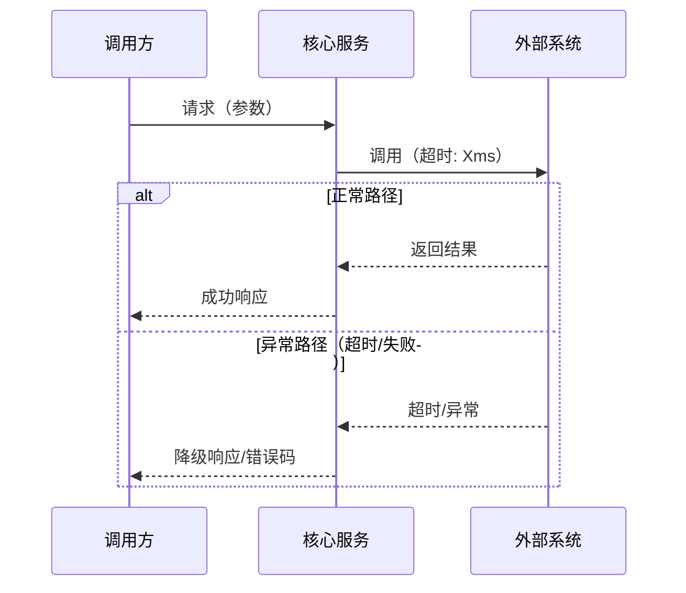

# 详细设计文档模板

| 项目 | 内容 |
|------|------|
| 版本 | V1.0 |
| 日期 | {{DATE}} |
| 编写人 | {{AUTHOR}} |
| 项目名 | {{PROJECT}} |
| 状态 | 草稿 |

---

## 变更记录

| 版本 | 日期 | 修改内容 | 编写人 |
|------|------|----------|--------|
| V1.0 | {{DATE}} | 初始化文档 | {{AUTHOR}} |

---

## Context 确认清单

> 生成文档后在此处列出所有从用户处收集的信息，请确认无误后继续填写详细内容。

| 信息项 | 确认内容 |
|--------|----------|
| 核心需求 | {{USER_STORY}} |
| 涉及系统 | {{SYSTEMS}} |
| 改动范围 | {{SCOPE}} |
| 性能要求 | {{PERF_REQ}} |
| 技术约束 | {{TECH_CONSTRAINTS}} |
| 发布节点 | {{RELEASE_DATE}} |

---

## 1. 需求定义

### 1.1 核心矛盾（一句话）🔴 强制

> 用一句话描述本次需求要解决的核心矛盾，不是功能描述。
>
> ✅ 正确：当前用户在 X 场景下因 Y 限制导致 Z 问题，本次通过 [方案] 解决。
> ❌ 错误：本次需求是新增 XX 功能。

```
{{CORE_CONFLICT}}
```

---

### 1.2 用户故事 🟡 P0 必填

> 只写影响验收的故事，不要把所有功能点翻译成用户故事格式。

| 序号 | 角色 | 场景描述 | 优先级 |
|------|------|----------|--------|
| 1 | [用户角色] | 作为[角色]，我希望[功能]，以便[价值] | P0 |
| 2 | [用户角色] | 作为[角色]，我希望[功能]，以便[价值] | P1 |
| 3 | [用户角色] | 作为[角色]，我希望[功能]，以便[价值] | P2 |

---

### 1.3 验收标准 🔴 强制

> 必须是可观测、可测量的条件。"系统正常运行"不是验收标准。

| 功能点 | 验收条件 | 测试方法 | 优先级 |
|--------|----------|----------|--------|
| [功能点1] | [具体可验证条件，如：接口返回 200 且 < 500ms] | [测试方法] | P0 |
| [功能点2] | [具体可验证条件] | [测试方法] | P1 |

---

### 1.4 功能边界 🔴 强制

> 不包含的内容和包含的内容同等重要。

**核心功能范围（包含）**
- [功能模块A]：[描述]
- [功能模块B]：[描述]

**非功能范围（明确不包含）**
- [本期明确不做的内容，例如：不包含退款流程]
- [TBD - 需补充]

**外部依赖**

| 依赖系统 | 依赖内容 | 接口方式 | 预期响应时间 |
|----------|----------|----------|-------------|
| {{SYSTEM_1}} | [依赖内容] | [HTTP/RPC/消息] | [时间要求] |
| {{SYSTEM_2}} | [依赖内容] | [HTTP/RPC/消息] | [时间要求] |

---

---

## 2. 设计阶段

> **设计阶段门禁**：Q1–Q5 必须全部回答并评审通过，才能进入迭代阶段。

---

### Q1：我在解决什么问题？ 🔴 强制

**技术侧的核心挑战**

```
[TBD - 从技术视角描述最大难点，不是复述需求]
```

**本次方案的边界**

| 维度 | 内容 |
|------|------|
| 解决了 | [本次方案覆盖的技术问题] |
| 未解决（已知遗留） | [有意识不解决的部分及原因] |

---

### Q2：为什么这样设计？（ADR）🔴 强制，至少 1 条

> 每个非显而易见的技术决策必须有一条 ADR。
> 判断标准：换一个工程师来，他可能做出不同选择，就需要记录。

#### ADR-001：[决策标题]

| 字段 | 内容 |
|------|------|
| 状态 | 已接受 / 待评审 / 已废弃 |
| 背景 | [什么约束或问题驱动了这个决策] |
| 备选方案 | 方案A：[描述及核心优劣] / 方案B：[描述及核心优劣] |
| 选择结果 | [选择了哪个方案] |
| 选择理由 | [为什么选这个，其他方案的核心缺陷] |
| 权衡取舍 | [放弃了什么，接受了什么代价] |
| 后果与风险 | [后续影响或潜在风险及应对] |

#### ADR-002：[决策标题]

| 字段 | 内容 |
|------|------|
| 状态 | |
| 背景 | |
| 备选方案 | |
| 选择结果 | |
| 选择理由 | |
| 权衡取舍 | |
| 后果与风险 | |

---

### Q3：正常路径是什么？ 🔴 强制

#### 技术约束 🟡 有新技术引入时必填

**技术选型**

| 约束项 | 约束内容 | 原因说明 |
|--------|----------|----------|
| 开发语言 | [语言版本] | [原因] |
| 框架版本 | [框架版本] | [原因] |
| 数据库 | [数据库类型版本] | [原因] |
| 中间件 | [中间件类型版本] | [原因] |

**性能约束**

| 指标项 | 约束值 | 说明 |
|--------|--------|------|
| 接口响应时间 | [P99 要求] | |
| 并发处理能力 | [QPS 要求] | |
| 系统可用性 | [99.9%] | |
| 数据一致性 | [强一致/最终一致] | |

**安全约束** ⚪ 有合规要求时填写

- 数据传输加密：[TLS 版本/算法]
- 敏感数据存储：[加密方式]
- 访问控制：[权限模型]
- 审计日志：[日志范围]

---

#### 主流程时序图 🔴 强制

> 要求：①必须包含至少 1 条异常分支；②每个外部调用标注超时时间。



---

#### 架构与模块设计 ⚪ 多模块改动时填写

**总体架构图**

```
[在此插入架构图]
```

**核心模块**

| 模块名称 | 职责描述 | 关键类/接口 | 依赖模块 |
|----------|----------|-------------|----------|
| [模块A] | [职责描述] | [关键类/接口] | [依赖模块] |
| [模块B] | [职责描述] | [关键类/接口] | [依赖模块] |

**数据模型** 🟡 有数据库变更时必填

| 表名/实体 | 字段 | 类型 | 说明 |
|-----------|------|------|------|
| [表名] | [字段1] | [类型] | [说明] |

---

#### 变更影响范围 🟡 多模块变动时必填

```
[在此插入变更影响模块图]
```

| 图形 | 含义 |
|------|------|
| 红色实线矩形 | 直接修改的模块 |
| 橙色虚线矩形 | 需联调的依赖模块 |
| 黄色实线圆柱 | 新增/变更数据模块（DB/缓存） |
| 箭头 | 调用方向 |

---

#### 接口清单 🔴 有新增接口时必填

| 接口名称 | 接口路径 | 请求方法 | 说明 |
|----------|----------|----------|------|
| [接口1] | [/api/v1/xxx] | POST | [接口说明] |
| [接口2] | [/api/v1/xxx] | GET | [接口说明] |

---

#### 集成要求 🟡 有外部系统集成时必填

**内部系统集成**

| 集成系统 | 集成方式 | 接口协议 | 数据格式 | 备注 |
|----------|----------|----------|----------|------|
| [系统A] | [同步/异步] | [HTTP/RPC/消息] | [JSON/XML] | |

**外部系统集成**

| 外部系统 | 集成方式 | 接口协议 | 认证方式 | 备注 |
|----------|----------|----------|----------|------|
| [外部服务A] | [同步/异步] | [HTTPS] | [OAuth/Token/API Key] | |

---

#### 资源申请 🟡 有新资源/配置/权限变更时必填

**配置项变更**

| 配置项 | 变更类型 | 原值 | 新值 | 影响范围 |
|--------|----------|------|------|----------|
| [配置项1] | [新增/修改/删除] | [原值] | [新值] | [影响范围] |

**权限申请**
- [ ] [新增接口/资源权限描述]

---

### Q4：出错了怎么办？ 🔴 强制

> 此问在 Q3 完成后立即回答，不可推迟到测试阶段。Q4 未完成不允许进入迭代阶段。

#### 外部依赖降级策略 🔴 强制

> Q3 中的每一个外部依赖，这里都必须有对应的降级方案。

| 外部依赖 | 故障场景 | 降级策略 | 用户体验影响 |
|----------|----------|----------|-------------|
| {{SYSTEM_1}} | [超时/不可用/返回异常] | [熔断/降级/重试/回退] | [影响描述] |
| {{SYSTEM_2}} | [超时/不可用/返回异常] | [熔断/降级/重试/回退] | [影响描述] |

#### 关键操作幂等性 🟡 有写操作/支付/状态变更时必填

| 操作 | 幂等策略 | 幂等键设计 |
|------|----------|------------|
| [操作A] | [唯一键/状态机/Token] | [幂等键来源和格式] |

#### 数据一致性异常处理 🟡 分布式事务/跨库操作时必填

```
[描述补偿机制、对账方案，或注明"本次无分布式事务场景，不适用"]
```

#### 监控与告警 🔴 强制

> 至少定义：成功率告警 + 核心接口 P99 告警。

| 监控项 | 监控指标 | 告警阈值 | 告警方式 |
|--------|----------|----------|----------|
| 成功率 | [成功请求数/总请求数] | < 99% | [告警方式] |
| P99 响应时间 | [核心接口 P99] | > [Xms] | [告警方式] |
| [业务指标] | [指标描述] | [阈值] | [告警方式] |

**关键日志埋点**

| 业务关键字 | 埋点位置 | 说明 |
|------------|----------|------|
| [关键字1] | [埋点描述] | [说明] |

#### 回滚方案 🔴 强制

| 措施 | 触发条件 | 操作步骤 | 操作人 | 预计恢复时长 |
|------|----------|----------|--------|-------------|
| F5 切流 | [条件] | [步骤描述] | [操作人] | [时长] |
| 业务开关 | [条件] | [步骤描述] | [操作人] | [时长] |
| Pod 回滚 | [条件] | [步骤描述] | [操作人] | [时长] |

---

### Q5：怎么证明它是对的？ 🔴 强制

#### 最可能出错的三个场景 🔴 强制，不能少于 3 个

| # | 场景描述 | 风险等级 | 验证方法（不依赖完整系统） |
|---|----------|----------|--------------------------|
| 1 | [TBD - 并发/边界/异常路径场景] | 高/中/低 | [单元测试/Mock/边界用例] |
| 2 | [TBD] | 高/中/低 | [单元测试/Mock/边界用例] |
| 3 | [TBD] | 高/中/低 | [单元测试/Mock/边界用例] |

#### 灰度策略 🟡 有用户流量影响时必填

| 项目 | 内容 |
|------|------|
| 灰度策略 | [按用户 ID / 地区 / 渠道分流] |
| 初始灰度比例 | [X%] |
| 放量条件 | [无异常告警持续 N 小时] |
| 全量条件 | [成功率 > X%，P99 < Xms] |
| 灰度观察周期 | [N 小时/天] |

---

---

## 3. 迭代阶段

> **阶段说明**：代码开发进行中，尚未交付测试。提测确认通过后正式进入测试阶段。

---

### 轨道一：设计验证轨 🔴 强制（Tech Lead 主导）

#### 模块实现计划

| 模块 | 实现内容 | 计划开始 | 计划完成 | 状态 |
|------|----------|----------|----------|------|
| [模块A] | [实现内容] | [日期] | [日期] | 待开发/开发中/已完成 |

#### 关键节点确认

| 节点 | 确认内容 | 确认时间 | 确认人 | 状态 |
|------|----------|----------|--------|------|
| 技术方案评审 | [评审内容] | [时间] | [确认人] | 待确认/已通过 |
| 代码评审 | [评审内容] | [时间] | [确认人] | 待确认/已通过 |
| 提测确认 | [确认内容] | [时间] | [确认人] | 待确认/已通过 |
| 发布确认 | [确认内容] | [时间] | [确认人] | 待确认/已通过 |

#### 代码评审记录 🔴 强制

> 评审聚焦"实现是否符合设计意图"，不是代码规范。若实现与设计不一致，必须记录偏差原因，不允许静默不一致。

| 模块 | 评审内容 | 设计偏差 | 偏差原因 | 处理结论 | 评审人 | 时间 |
|------|----------|----------|----------|----------|--------|------|
| [模块A] | [评审内容] | [有/无] | [设计错误/实现妥协/需求变更] | [更新设计文档/接受偏差并记录] | [评审人] | |

---

### 轨道二：质量保证轨 🔴 强制（开发主导）

#### 自测用例清单

> 必须覆盖 Q5 中定义的三个出错场景。

| 接口/功能 | 用例描述 | 预期结果 | 测试结果 |
|-----------|----------|----------|----------|
| Q5-场景1 | [对应场景验证] | [预期结果] | 通过/失败 |
| Q5-场景2 | [对应场景验证] | [预期结果] | 通过/失败 |
| Q5-场景3 | [对应场景验证] | [预期结果] | 通过/失败 |
| [其他接口] | [用例描述] | [预期结果] | 通过/失败 |

#### 增量代码扫描报告 🟡 有安全合规要求时必填

```
[扫描结果摘要 / 暂无]
```

#### 上线镜像清单 🔴 发布前必填

| 应用 | 环境 | 环境标识 | 镜像地址 |
|------|------|----------|----------|
| [应用名称] | 开发环境 | system-dev | [镜像地址] |
| [应用名称] | 准生产环境 | system-uat | [镜像地址] |
| [应用名称] | 生产环境 | system-pro | [镜像地址] |

---

### 轨道三：同步协调轨 ⚪ 选填（PM 主导）

#### 同步机制

| 同步事项 | 同步方式 | 同步频率 | 同步人 |
|----------|----------|----------|--------|
| [同步事项1] | [会议/邮件/IM] | [频率] | [同步人] |

#### 问题升级机制

| 问题级别 | 升级条件 | 升级时限 | 升级人 |
|----------|----------|----------|--------|
| P0 | [阻塞发布/数据异常/线上故障] | 15 分钟内 | [升级人] |
| P1 | [影响迭代节点/外部依赖故障] | 4 小时内 | [升级人] |

---

---

## 4. 测试阶段

> **进入条件**：迭代阶段提测确认节点通过。

### 测试用例报告 🔴 强制

| 用例编号 | 用例描述 | 测试类型 | 测试结果 | 缺陷数 |
|----------|----------|----------|----------|--------|
| [编号] | [用例描述] | [功能/性能/集成] | 通过/失败 | [缺陷数] |

### 环境验收清单 🔴 强制

| 类别 | 验收项 | 验收结果 | 备注 |
|------|--------|----------|------|
| 测试环境 | 环境配置 | 通过/未通过 | |
| 测试环境 | 权限配置 | 通过/未通过 | |
| 测试环境 | 数据库表 | 通过/未通过 | |
| 配置 | 中间件配置 | 通过/未通过 | |
| 配置 | 网络配置 | 通过/未通过 | |

---

---

## 5. 发布阶段

> **进入条件**：测试全部验收通过，发布评审完成。

### 发布物料清单 🔴 强制

| 物料类型 | 物料名称 | 版本 | 存放位置 | 备注 |
|----------|----------|------|----------|------|
| [类型] | [名称] | [版本] | [位置] | |

### 配置变更 🟡 有配置变更时必填

| 配置项 | 变更类型 | 变更内容 | 生效时间 | 变更人 |
|--------|----------|----------|----------|--------|
| [配置项] | [新增/修改/删除] | [变更内容] | [时间] | [变更人] |

### 数据库变更脚本 🟡 有数据库变更时必填

```sql
-- [SQL 变更脚本 / 无]
```

---

---

## 6. 验证阶段

> **进入条件**：发布完成，灰度流量已切入。

### 灰度验证报告 🔴 强制

| 验证项 | 验证内容 | 验证结果 | 验证人 | 时间 |
|--------|----------|----------|--------|------|
| 成功率 | [实际 vs 告警阈值] | 通过/未通过 | [验证人] | |
| P99 响应时间 | [实际 vs 性能约束] | 通过/未通过 | [验证人] | |
| 业务核心指标 | [核心业务指标是否正常] | 通过/未通过 | [验证人] | |

### 业务测试确认 🔴 强制

| 接口/场景 | 测试结果 | 确认人 | 确认时间 |
|-----------|----------|--------|----------|
| [核心业务场景] | 通过/失败 | [确认人] | |

---

---

## 7. 回滚阶段

> **触发条件**：验证阶段发现异常且无法快速修复，按 Q4 回滚方案执行。

### 应急回滚报告 🔴 触发回滚时必填

| 项目 | 内容 |
|------|------|
| 问题现象 | [问题描述] |
| 回滚时间 | [时间] |
| 恢复时间 | [时间] |
| 影响时长 | [时长] |
| 影响范围 | [范围描述] |
| 根因分析 | [分析结果，事后 24 小时内完成] |

---

---

## 附录

### 术语表

| 术语 | 定义 |
|------|------|
| ADR | Architecture Decision Record，架构决策记录 |
| First One 原则 | 优先完成最小可交付核心内容，再逐步补充细节 |
| 提测确认 | 开发向测试正式交接的节点 |
| 设计偏差 | 实际实现与设计文档不一致，必须记录原因和处理结论 |

### 参考文档

| 文档名称 | 文档链接 |
|----------|----------|
| [文档1] | [链接] |