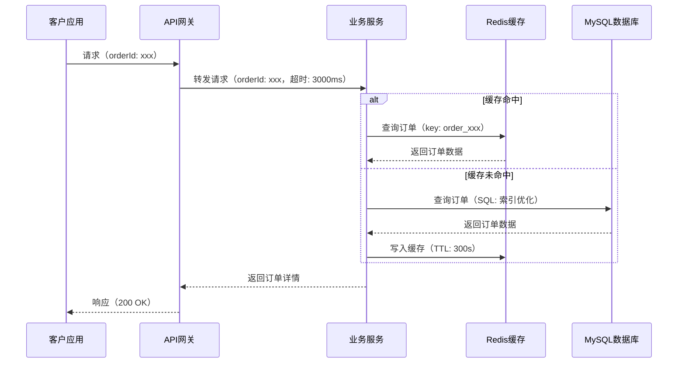
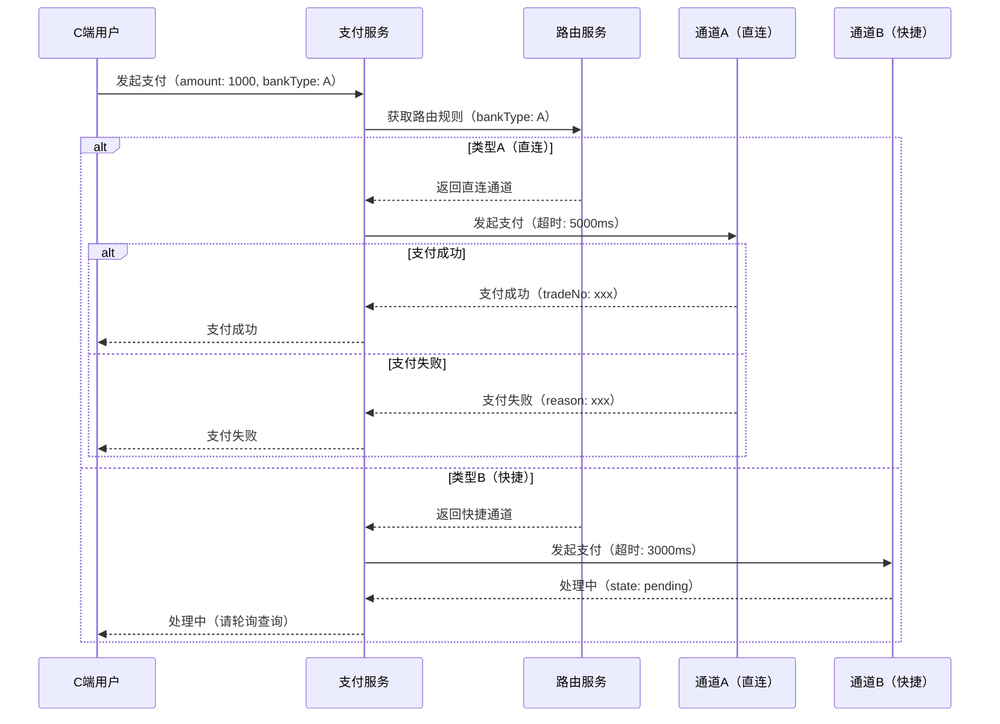
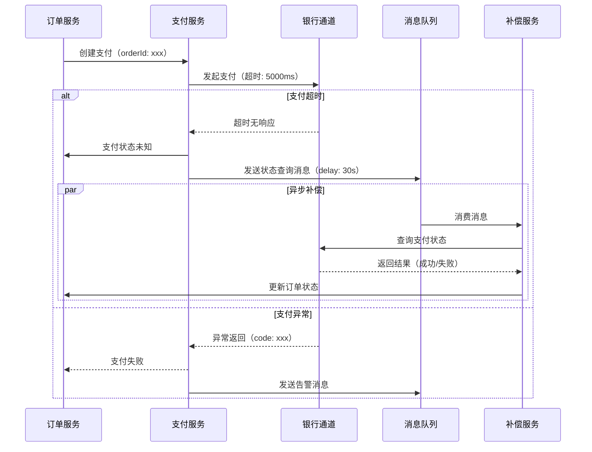
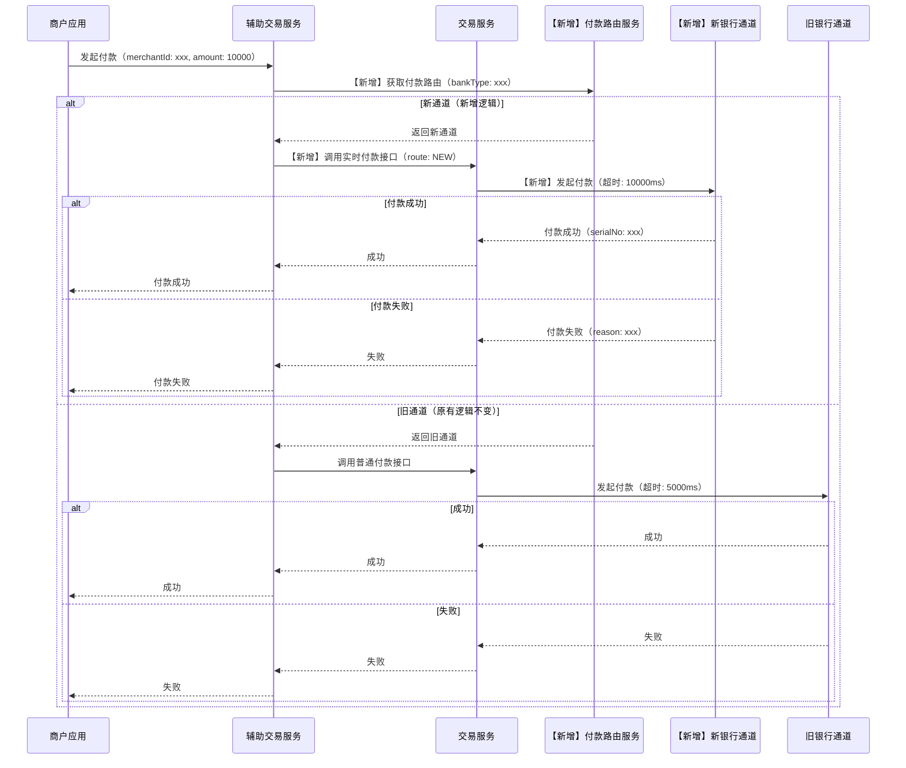
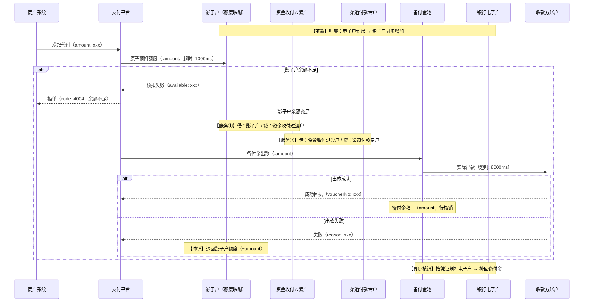

# 时序图生成 Skill

## 核心原则

生成时序图时，必须严格遵守以下三大原则：

**1. 完整性原则**
- 必须包含至少 1 条异常分支路径（使用 `alt/else`）
- 每个外部系统调用必须标注超时时间（如：`超时: 3000ms`）
- 必须标注关键的数据状态变更（如：订单状态、支付状态）

**2. 清晰性原则**
- 参与者名称使用业务术语，避免技术缩写（使用 `participant A as 业务名称`）
- 消息线上标注关键参数或业务标识（如：`orderId: xxx`）
- 条件分支使用 `alt/else` 清晰区分正常与异常路径

**3. 可维护性原则**
- 新增功能使用 `【新增】` 标记，便于识别变更点
- 复杂分支可拆分为多个时序图（主流程图 + 异常流程图）
- 关键决策点添加注释（`Note over A,B: 说明`）

---

## 工作流程

收到时序图生成请求时，按以下步骤执行：

### Step 1：场景识别与澄清问题输出

**在画图之前**，先根据用户描述识别场景类型，主动输出需要澄清的问题。

不同场景有不同的高风险模糊点，对应澄清问题如下：

#### 场景识别规则

| 场景关键词 | 识别场景 | 必须澄清的问题 |
|-----------|---------|--------------|
| 支付、代付、出款、转账、收款 | **资金流转场景** | 见下方《资金流转澄清清单》 |
| 账户、余额、扣款、充值、核销 | **账务处理场景** | 见下方《账务处理澄清清单》 |
| 退款、冲正、撤销、补偿 | **逆向流程场景** | 见下方《逆向流程澄清清单》 |
| 定时、批量、异步、队列 | **异步处理场景** | 见下方《异步处理澄清清单》 |
| 新增、改造、存量、兼容 | **存量改造场景** | 见下方《存量改造澄清清单》 |
| 风控、校验、审核、拦截 | **风控审核场景** | 见下方《风控审核澄清清单》 |

> 一个场景可能命中多个类型，需合并对应的澄清问题，去重后输出。

---

#### 《资金流转澄清清单》

1. **资金来源**：资金从哪个账户/池子出？是备付金垫付还是商户自有资金？
2. **账户归属**：涉及的账户归属是商户的还是平台的（如电子户是谁开的）？
3. **成功判定**：出款成功的标准是什么？是银行回执还是收款方到账确认？
4. **失败处理**：出款失败后资金如何退回？退回路径和原路径是否一致？
5. **并发安全**：是否存在同一账户并发扣款的场景？额度扣减是否需要原子操作？
6. **最终一致性**：资金流转是实时结算还是异步核销？窗口期内敞口如何管控？

#### 《账务处理澄清清单》

1. **账务分录**：每个资金流转动作对应的借贷关系是什么（借哪个账户/贷哪个账户）？
2. **余额定义**：各账户余额的含义是什么？是实时余额还是可用余额（扣除预占后）？
3. **映射关系**：虚拟账户（影子户）和实体账户的映射规则是什么？何时同步更新？
4. **核销时机**：核销动作是实时触发还是定时批量？核销失败如何处理？
5. **透支边界**：哪个账户允许透支？透支上限如何设定？透支后如何补足？
6. **冲销规则**：失败场景下账务如何冲销？冲销是否需要人工审核？

#### 《逆向流程澄清清单》

1. **退款触发**：退款由谁发起？是商户主动申请还是系统自动触发？
2. **退款路径**：退款资金走原路退还是走单独的退款通道？
3. **退款时效**：退款是实时到账还是 T+N？不同场景时效是否不同？
4. **部分退款**：是否支持部分退款？部分退款的账务如何处理？
5. **退款失败**：退款失败后如何处理？是重试还是人工介入？

#### 《异步处理澄清清单》

1. **触发方式**：异步任务是定时轮询还是事件驱动（消息队列）？
2. **幂等保证**：异步任务是否需要幂等控制？幂等 key 是什么？
3. **失败重试**：任务失败后重试几次？重试间隔如何设置？超过上限后如何处理？
4. **顺序保证**：多任务之间是否有顺序依赖？是否需要串行执行？
5. **对账机制**：异步处理完成后是否需要对账补偿？对账周期是多久？

#### 《存量改造澄清清单》

1. **改造边界**：哪些是新增逻辑？哪些是原有逻辑保持不变？
2. **兼容策略**：新老逻辑如何共存？是灰度切流还是开关控制？
3. **回滚方案**：新逻辑出问题时如何回滚？回滚是否影响存量数据？
4. **数据迁移**：是否涉及存量数据迁移？迁移期间如何保证业务连续性？

#### 《风控审核澄清清单》

1. **审核同步性**：风控审核是同步阻塞还是异步通知？
2. **审核超时**：风控系统超时后如何处理？是默认放行还是默认拒绝？
3. **人工审核**：是否存在需要人工介入的风控场景？人工审核的 SLA 是多少？
4. **拦截后处理**：被风控拦截的请求，资金如何处置？是否需要通知商户？

---

#### 澄清问题输出格式

识别场景后，按以下格式向用户输出澄清问题，**不要直接画图**：

```
我识别到这是一个 [场景类型] 场景，在画图前有几个关键点需要确认，避免后续返工：

【必须确认】
1. [最高优先级问题，直接影响主流程走向]
2. [次优先级问题，影响分支设计]

【建议确认】
3. [影响细节设计的问题]
4. [影响异常处理的问题]

如果你已经有答案，可以直接告诉我；如果暂时不确定，我可以先按最常见的方案画，后续调整。
```

**例外规则**：如果用户描述已经非常详细（包含账户归属、资金路径、异常处理），可跳过澄清直接画图，但需在图后附上「假设说明」列出绘图时做的默认假设。

---

### Step 2：理解需求（澄清后执行）

从用户描述和澄清回答中提取：
- 涉及的系统/服务有哪些（参与者）
- 主流程是什么
- 是否有新增功能需要标注 `【新增】`
- 已确认的异常场景和处理方式

### Step 3：选择模板

根据场景选择对应模板（见下方模板库），填充参与者和业务细节。

### Step 4：补全要素

确保以下内容都已包含：
- [ ] 主流程路径（从请求到响应闭环）
- [ ] 至少 1 条 `alt/else` 异常分支
- [ ] 外部调用的超时时间
- [ ] 关键状态变更标注
- [ ] 参与者业务命名清晰

### Step 5：输出

输出完整的 Mermaid 代码块，并附上：
1. 一句话说明图的结构
2. 「假设说明」——列出绘图时未经用户确认而做的默认假设，方便用户校对

---

## 模板库

### 模板一：基础服务调用（缓存/数据库读写）



### 模板二：多分支路由（支付/通道选择）



### 模板三：异常补偿（超时/消息队列）



### 模板四：【新增】功能标注（存量改造）



### 模板五：资金流转 + 账务分录（备付金/影子户场景）



---

## Mermaid 语法速查

```
# 参与者声明
participant A as 调用方
participant B as 服务B

# 同步调用 / 返回
A->>B: 消息（参数，超时: 3000ms）
B-->>A: 返回结果

# 条件分支
alt 条件1
    B->>C: 处理1
else 条件2
    B->>D: 处理2
end

# 并行处理
par 并行任务
    B->>C: 处理1
and
    B->>D: 处理2
end

# 循环
loop 重试3次
    B->>C: 重试
end

# 注释
Note over A,B: 关键说明
Note right of A: 右侧注释
```

---

## 交付检查清单

生成时序图后，在输出前自检以下内容：

- [ ] 是否已输出场景澄清问题（或在描述充分时附上假设说明）
- [ ] 主流程路径完整，从请求到响应闭环
- [ ] 至少包含 1 条 `alt/else` 异常分支
- [ ] 每个外部系统调用标注超时时间
- [ ] 关键数据状态变更已标注
- [ ] 参与者命名清晰，符合业务术语
- [ ] 【新增】功能已正确标记（如有）
- [ ] 复杂条件分支有对应的 `else`
- [ ] 需要异步补偿的场景包含消息队列
- [ ] 资金流转场景账务分录借贷方向正确
- [ ] 图后附上「假设说明」列出默认假设
