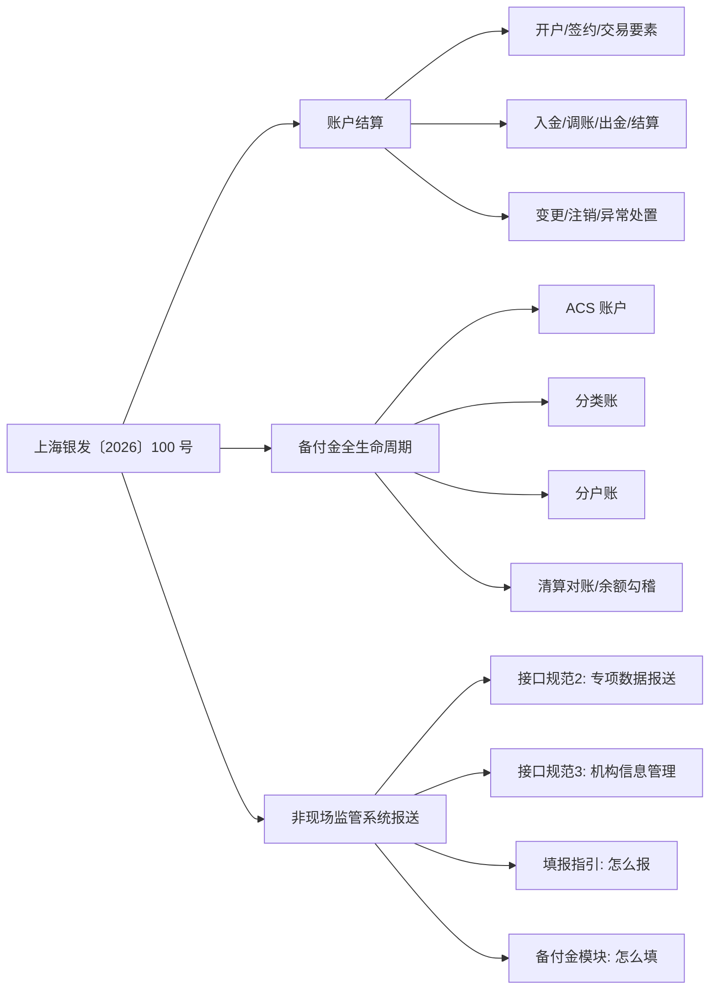

# 账户清算侧 2026 支付结算重点工作材料

> 会前结构稿。用途：基于上海银发〔2026〕100 号和非现场监管培训材料，说明账户、结算、备付金、非现场检查系统的本次工作安排。

## 1. 一页总览

### 本次账户清算侧承接 3 条主线

### 会议先讲清楚 3 个数字

| 数字 | 含义 | 账户清算侧要表达的重点 |
|---|---|---|
| `47 张` | 规范一数据表，进入机构端可信数据区，并供非现场监管系统按需采集。 | 不是临时报表，是监管数据接口和可信数据区建设。 |
| `2 张` | 规范二本地留存表：客户信息、商户信息，仅在机构端可信数据区留存。 | 敏感信息本地留存，监管触发核查时可追溯。 |
| `19 张` | 备付金模块采集表，去重后涉及 57 个字段。 | 这是备付金模块的填报口径，不等于非现场全部口径。 |

## 2. 非现场检查系统：本次报送什么

### 2.1 总体口径

本次非现场检查系统不是“填表”，而是把机构业务数据加工成监管接口规范要求的数据，放入可信数据区，通过 SFTP、加密验签、字段校验、回执处理形成常态化报送闭环。

| 类别 | 表数量 | 去向 | 当前说明 |
|---|---:|---|---|
| 规范一 | 47 张 | 机构端可信数据区，并供非现场监管系统采集到中心端数据处理区 | 覆盖机构、账户、备付金、交易、结算、统计等监管数据。 |
| 规范二 | 2 张 | 仅机构端可信数据区本地留存 | 客户信息、商户信息本地化留存，不直接向中心端报送。 |

### 2.2 四份核心材料与账户清算落点

这部分不能只讲“备付金 19 张表”。本次非现场准备应按四份材料分层：先用接口规范确定“报什么”，再用填报指引确定“怎么报”，最后用备付金模块材料确定账户清算侧“怎么填、怎么核”。

| 材料 | 解决的问题 | 账户清算侧要做什么 |
|---|---|---|
| `【技术培训-接口规范2】支付机构非现场监督管理系统-数据接口规范V2.0-专项数据报送-0530.pdf` | 专项数据报送口径：哪些专项数据表需要进入非现场接口规范，字段、频次、适用条件、监管指定报送范围是什么。 | 从专项数据报送范围里圈出账户、清算、备付金、待结算资金、交易汇总、统计报送相关表，标记“主责 / 配合 / 不适用 / 监管指定时提供”。 |
| `【技术培训-接口规范3】支付机构非现场监督管理系统数据接口规范填报说明-机构信息管理-0530.pdf` | 机构信息管理口径：公司及分支机构、董监高、股权、机构基础信息等怎么填。 | 账户清算不是主责，但要配合合规确认机构、账户、分支、系统接入和联系人等基础信息是否影响报送主体和账户归属。 |
| `【技术培训-填报指引】支付机构非现场监督管理系统数据填报指引-0530.pdf` | 填报执行规则：文件、字段、枚举、日期、金额、空值、频次、补报重报、校验和回执怎么处理。 | 把账户清算数据加工规则固化成填报 SOP：字段来源、金额单位、日期口径、空值规则、报送频次、补报重报和差异处理。 |
| `备付金模块数据接口及填报20260601.pptx` | 备付金模块怎么填：ACS、分类账、分户账、客户清单、交易要素、清算核验之间如何勾稽。 | 负责把“谁的钱、什么业务的钱、什么时候影响 ACS”讲清楚，并落到分类账、分户账、调账、入金、出金、余额核对。 |

### 2.3 备付金模块：19 张表只作为子模块展开

备付金模块采集 19 张表、去重后 57 个字段。这里的重点不是把 19 张表当成全部非现场范围，而是把它作为账户清算侧最需要落地的填报样例：从客户清单和交易要素开始，拆到 ACS、分类账、分户账，再和清算机构数据核验。

| 组别 | 涉及表 | 我们要讲的重点 |
|---|---|---|
| 主体和交易要素 | 支付机构客户清单、支付机构客户交易要素登记表 | 客户 ID、客户类型、商户号/账号、交易方向、清算机构、业务类型要可追溯。 |
| 分类账 | 分类账余额、分类账入金、分类账调账、分类账出金 | 回答“什么业务的钱”，按业务类型拆 ACS 账户资金。 |
| 分户账 | 分户账余额、分户账入金、分户账调账、分户账出金 | 回答“谁的钱”，按客户/商户/暂挂户/自有资金拆余额和变动。 |
| 清算核验 | ACS 账户时点余额、清算机构按业务类型和交易要素的入出金统计、一阶段/二阶段核验、结算资金与交易匹配 | 用清算机构和 CFS 数据校验我们自己的分类账、分户账和 ACS 余额。 |
| 适用性确认 | 预付卡商户资金结算流水等预付卡相关表 | 如果公司不经营预付卡，要形成不适用说明；如果涉及，则纳入专项表清单。 |

### 2.4 报送链路

### 2.5 本次非现场检查要形成的交付物

| 交付物 | 内容 | 负责人建议 |
|---|---|---|
| 表清单责任矩阵 | 基于接口规范2、接口规范3，把 47+2 中哪些表由账户清算提供、哪些配合、哪些不适用逐项标记。 | 账户清算 + 合规 + 数据 |
| 填报 SOP | 基于填报指引明确字段格式、枚举、日期、金额、空值、频次、补报重报和回执处理。 | 数据 + 技术 + 账户清算 |
| 备付金模块字段映射 | 基于备付金 PPT 梳理 19 张表字段来源、口径、加工规则、数据负责人。 | 账户清算 + 数据 |
| 核验规则清单 | ACS、分类账、分户账、清算机构统计之间的勾稽关系。 | 清算 + 财务 |
| 联调与报送计划 | SFTP、文件目录、加密验签、生产验证、回执处理。 | 技术 + 数据 + 账户清算 |
| 差异整改台账 | 报送失败、字段错误、余额不平、清算差异、补报重报记录。 | 账户清算 + 技术 + 合规 |

## 3. 账户结算：全生命周期管理

### 3.1 管理对象

| 对象 | 生命周期环节 | 关键控制点 |
|---|---|---|
| 客户 / 商户 | 入网、签约、状态变更、注销 | 客户 ID 唯一，客户类型准确，证件和名称敏感信息按规则处理。 |
| 交易要素 | 登记、变更、停用 | 商户号、账号、交易方向、清算机构、业务类型必须可追溯。 |
| 结算账户 | 开立、使用、变更、撤销 | 同名结算、账户用途、异常结算、非同名或跨主体资金流重点排查。 |
| 分类账 | 初始余额、入金、调账、出金、日终余额 | 回答“什么业务类型的钱”。 |
| 分户账 | 初始余额、入金、调账、出金、日终余额 | 回答“谁的钱”。 |
| ACS 账户 | 日终余额、时点余额、清算出入金 | 与分类账、分户账、清算机构数据做总分核对。 |

### 3.2 账户清算侧要补齐的规则

| 规则 | 说明 |
|---|---|
| 业务类型不能主观判断 | 根据清算对账文件、原始交易报文和清算机构业务类型映射表确定。 |
| 跨机构交易按收付实现制 | 资金实际影响 ACS 账户余额的日期，作为入金/出金填报日期。 |
| 本代本调账按发生日记录 | 不影响 ACS 总余额，但会改变客户归属或业务类型归属。 |
| 余额必须可勾稽 | 分类账余额合计、分户账余额合计、ACS 账户余额之间要能解释差异。 |
| 暂挂户必须定期清理 | 充值归集、提现暂挂、异常挂账要有账龄、原因、处理人和闭环。 |

## 4. 备付金：全生命周期管理

### 4.1 管理主线

### 4.2 重点检查项

| 检查项 | 要看什么 | 产出 |
|---|---|---|
| ACS 与账务总额 | ACS 时点余额、分类账合计、分户账合计是否一致。 | 日终核对表 |
| 资金归属 | 每笔余额是否能落到客户、商户、暂挂户或自有资金户。 | 分户账余额明细 |
| 业务类型 | 收单结算、支付账户、预付卡、自有资金、暂挂账是否分类准确。 | 业务类型映射表 |
| 入金出金 | 入出金是否按实际影响 ACS 日期记录。 | 入出金明细核验 |
| 内部调账 | 分账、转账、垫资回收、暂挂转出是否有调账记录。 | 调账台账 |
| 异常资金 | 负余额、长期暂挂、非同名结算、沉淀异常、账实不符。 | 异常清单和整改闭环 |

## 5. 推进计划

| 阶段 | 时间建议 | 主要动作 | 输出 |
|---|---|---|---|
| 1. 范围冻结 | 第 1 周 | 冻结 47+2 表清单，标记账户清算主责、配合、不适用。 | 表清单责任矩阵 |
| 2. 规范和指引拆解 | 第 1-2 周 | 先按接口规范2、接口规范3拆表范围和适用性，再按填报指引固化字段、频次、文件、回执和补报规则。 | 表清单 + 填报 SOP |
| 3. 数据试跑 | 第 2-3 周 | 跑一批样例数据，校验分类账、分户账、ACS、清算数据。 | 试跑结果和差异清单 |
| 4. 联调验证 | 第 3-4 周 | 验证 SFTP、加密验签、文件目录、回执、补报重报。 | 联调记录 |
| 5. 常态化运行 | 月度/季度 | 报送监控、差异整改、账户备付金生命周期复盘。 | 月度报送与整改台账 |

## 6. 五分钟讲稿

这次账户清算侧主要承接三件事：账户结算、备付金全生命周期管理、非现场监管系统报送。

第一，非现场监管系统先讲范围。本次不是临时报表，而是监管数据接口和可信数据区建设。总口径是规范一 47 张表，需要进入机构端可信数据区并供系统采集；规范二 2 张客户和商户信息表，仅在机构端本地留存。

第二，本次非现场准备要按四份材料拆：接口规范2看专项数据报送范围，接口规范3看机构信息管理，填报指引看文件、字段、频次、回执和补报规则，备付金模块 PPT 看账户清算侧怎么填、怎么核。备付金模块涉及 19 张表、57 个去重字段，但它只是账户清算重点模块，不等于全部非现场范围。

第三，备付金模块里，我们主责的是支付机构侧的客户清单、交易要素、分类账余额和入金调账出金、分户账余额和入金调账出金。清算机构和 CFS 侧会提供 ACS 时点余额、按业务类型和交易要素的入出金统计、核验情况、结算资金和交易匹配等数据。我们的重点是把这些数据对齐，形成勾稽关系。

第四，账户结算要按全生命周期管理。客户和商户从入网、签约、交易要素登记，到入金、调账、出金、结算，再到变更和注销，都要有可追溯记录。分类账回答“什么业务的钱”，分户账回答“谁的钱”，ACS 账户回答“总账余额是多少”。三者必须能对得上，差异必须能解释。

第五，备付金管理重点不是看账面余额，而是看资金是否被挪用、占用、混用，是否存在非同名结算、长期暂挂、异常沉淀、负余额、账实不符。我们后续会按日核对 ACS、分类账、分户账、清算入出金和内部调账，把异常形成整改台账。

后续计划分五步：第一周冻结 47+2 表清单和责任矩阵；第一到第二周完成接口规范2、接口规范3、填报指引和备付金模块的拆解；第二到第三周试跑样例数据；第三到第四周完成联调验证；之后进入常态化报送、差异整改和月度复盘。

## 7. 需要会后确认

| 问题 | 为什么要确认 |
|---|---|
| 公司是否经营预付卡业务 | 决定预付卡相关表是报送、配合还是不适用说明。 |
| 支付账户充值是否存在垫资模式 | 影响充值归集、自有资金分户、垫资回收和分户账填法。 |
| 商户结算是否存在非同名或特殊路径 | 影响收单结算账户一致性排查和整改。 |
| 47+2 中哪些表已具备数据源 | 决定联调前的数据补齐范围。 |
| ACS、分类账、分户账当前能否日终自动核对 | 决定备付金全生命周期管理的系统改造量。 |

## 8. 证据边界

- 上海支付结算重点工作依据：`wiki/reports/shanghai-payment-settlement-priorities-2026-h5.html`、`wiki/sources/shanghai-payment-settlement-priorities-2026-05-21.md`。
- 非现场系统材料依据：桌面 `C:\Users\yan\Desktop\非现场` 中 0528/0601 培训材料，以及已整理页 `wiki/sources/2026-05-28-training-debugging-notes.md`、`wiki/sources/nonbank-psoss-simplified-trusted-data-zone-2026-05-28.md`。
- 本材料是会前结构稿，不是监管报送口径最终版；正式提交前需要合规、技术、数据、账户清算负责人确认字段、频次和不适用范围。
